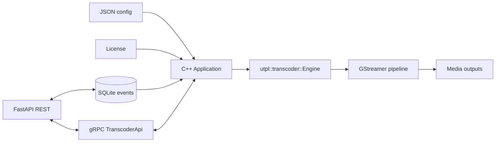
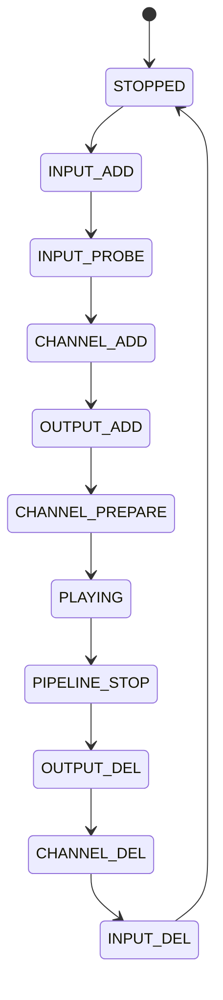

# System Architecture and Lifecycle

## Startup

`app/src/main.cpp` parses CLI paths, loads and validates the license, creates `Application`, and enters its lifecycle. `Application::configure` first parses logger/debug settings, then full configuration, applies configured GStreamer plugin ranks, validates the database path and license-server URL, and validates input/output restrictions. It constructs a SQLite event provider when a database path is supplied, a gRPC API server, and an application-level transcoder worker.

The worker owns an `Engine`; the engine creates one GStreamer `Pipe`, selects an input implementation, builds single outputs before group outputs, configures `Channel` and `Blanker`, then starts event scheduling after entering playback.

## Exit status

The process exits with the `utpl::Error` value of the reason it stopped (`lib/common/include/utpl/common/types.h`):

| Exit | `utpl::Error` | Cause |
| --- | --- | --- |
| 0 | `NO_ERROR` | A requested stop (SIGINT, which Supervisor's `stopsignal=INT` sends) or a finished file input. |
| 4 | `INVALID_ARGUMENT` | Missing/invalid CLI paths or a configuration the parser refuses. |
| 10 | `PIPELINE_ERROR` | The engine thread stopped on a pipeline failure, for example an input that cannot be opened. |
| 11 | `LICENSE_ERROR` | License invalid, expired or not yet valid at startup, or reported invalid by the license manager while running. |
| other | `utpl::Error` value | Any other `utpl::Exception` reaching `main` or the engine thread. |

A failure on the engine thread is recorded by `Application::Pimpl::onTranscoderStopped` unless a stop was already requested, so an error raised while shutting down on request still exits 0. `--license-info` has its own exit codes ([22](22-licensing-crypto-and-security.md#inspecting-a-license)).

Under Supervisor's `autorestart=unexpected` with the default `exitcodes=0`, every non-zero exit is restarted. The engine takes longer than the default `startsecs=1` to reach configuration validation, so a refused config counts as a started process and is retried indefinitely (`BACKOFF`/`STARTING`) rather than reaching `FATAL`.

## Engine states

The transitions are implemented in `lib/utpl/src/utpl/transcoder/engine.cpp`. Pipeline EOS requests stop. Pipeline errors set `PIPELINE_ERROR`, stop, and interrupt the engine loop. Do not infer a state transition from enum order alone; the implementation uses explicit up/down transition maps and handlers.

## Ownership and async boundaries

The project wraps GStreamer pointers in UTPL pipeline classes, with `Pipe` handling bus messages and `Element`/`Pad`/`Bin` handling state, links, request pads, and ghost pads. C++ Pimpl objects and `shared_ptr`/`unique_ptr` own most high-level graph objects. GLib main-loop callbacks, GStreamer dynamic-pad signals, pipeline bus watches, scheduler tasks, uploader threads, and API/worker threads are all lifetime boundaries; see 20 before modifying them.
