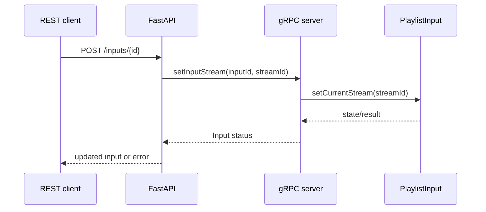

# Playlists, Buffering, and Switching

`PlaylistInput` is a production input class, separate from HLS playlists. It consumes a `pls+` URI and uses `utpl::playlist::Parser` to parse an M3U8 input playlist. The JSON document configures the transcoder and points to that M3U8; production source has no JSON playlist-file parser.

## Construction

The playlist input owns separate audio/video `PlaylistStream` paths. It uses `concat` for continuous media sequence, and uses an output selector/fakesink/text overlay in selected paths. It maintains current, pending, and preloaded items, creates `SingleInput` objects for playlist entries, and loops through the list.

## Supported entry types

Source switches recognize file, SRT, UDP, and HTTP/HLS-oriented paths through the normal URI parsing layer. An entry is not automatically supported merely because it appears in the documentation: protocol filtering and several FLUSH/error paths have explicit TODOs.

## The EXTINF title is parsed as an attribute list

`utpl::playlist::Parser` reads each `#EXTINF` line through `utils::M3U8`, which splits everything
after the duration on commas and treats each token as an attribute. That is how per-entry options
such as `scte35Source=manifest`, `user=`, `password=` and `bandwidth=` reach an HTTP entry.

A conventional title - a plain clip name - is therefore also parsed as an attribute value, and until
2026-08-18 a value containing `.` or `/` was passed straight to `std::stof`. Any real rundown line
(`#EXTINF:-1,clip.mp4`) threw `std::invalid_argument` out of the parser, and the channel died during
`INPUT_PROBE` with nothing logged but `Transcoder thread caught unknown exception`. Both conversions
now fall back to a plain enum value, the way the integer branch always did
(`lib/common/src/utpl/common/utils/m3u8.cpp`).

One consequence of the same design remains: entries are read as strict tag/URI couples starting at
index 1, so a comment line between `#EXTM3U` and the first `#EXTINF` shifts every pairing and the
playlist is rejected with `does not contain any valid playback items`. Generated playlists must not
carry comments.

## Control plane

The gRPC `TranscoderApi` exposes `getInputs`, `getInput`, and `setInputStream`. The FastAPI `/inputs` endpoints map REST models to these gRPC calls. A stream reports `UNKNOWN`, `CREATED`, `BUFFERING`, or `BUFFERED`; a switching request can be rejected if the desired stream is not in a valid state.

There are two different counts:

- The engine input count is the length of `GET /inputs`. From configuration version 1.5.0 the whole
  `transcoder.inputs` array is parsed, so a channel that uses ad insertion reports two inputs; older
  configurations still describe exactly one. `inputs[0]` is the programme source and defines the
  output topology. See [34](34-scte-ad-insertion.md).
- The switch-target count for that input is `GET /inputs | .[0].streams | length`. For a playlist, this is the number of parsed M3U8 items exposed by the engine.

`POST /inputs/{inputId}` is asynchronous for `PlaylistInput`. The success response can still carry the old `currentStreamId`; a following `GET /inputs` carries the requested ID. Clients should poll until the target is current and should separately monitor media continuity.

## Freezing a playlist off air

`PlaylistInput::setPlaybackActive(false)` locks the input's bin state and pauses it, together with
the current item's own bin, and suspends the position watch; `true` reverses it. An input declared
with `offAir: "pause"` is frozen once the pipeline reaches PLAYING, which also leaves it prerolled
so the next switch onto it is a state change rather than a fresh preroll.
`PlaylistStream::synchronizeClock` re-anchors the frozen timeline onto the channel's running time
through the existing concat pad offsets when the connector selects the stream.

Retained position is the *source* position, not the aired one; see the measured limitation in
[34](34-scte-ad-insertion.md).

## Managed playlist snapshots

The optional `playlist.mode: "managed"` configuration retains the normal `pls+file://` seed but
uses stable SQLite queue-item UUIDs after API reconciliation. The control plane sends complete,
ordered snapshots to `PlaylistInput`; this lets insertion, deletion and reorder survive restart
without the media graph reading SQLite directly. The active item cannot be removed, and the final
item cannot be removed, so the continuous loop remains valid. A changed preloaded-next item is
discarded and rebuilt before it can air.

A fresh engine process has no managed identities yet: it boots from the materialized M3U8 with
generated stream IDs. `PlaylistInput::applyPlaylistSnapshot` therefore allows an initial rebind by
URI while `_playlistRevision == 0` (`allowInitialUriRebind`); after that, an on-air stable ID that is
absent from the snapshot is refused with `INVALID_STATE`. Anything that rewrites the queue at
startup — including the declarative channel bootstrap — must therefore materialize
`MANAGED_PLAYLIST_FILE` *after* it writes the new queue, or the engine will permanently refuse the
first snapshot and the reconciler will park in `apply_error`.

## Verification requirements

Stable-ID insertion into a live loop is runtime verified: an inserted item plays in sequence and the loop then returns to the original items. Managed Skip changes the engine item and the decoded output without changing the queue revision. Output carries H.264 1920x1080/25, AAC 48 kHz stereo, and the SCTE/data PID with monotonic audio and video timestamps.

Still exercise SRT and HLS entries independently, and automate the currently manual preload/reorder/removal, source-error, hostile-filename, and mixed-rate vectors. A receiver that joins UDP mid-GOP can log PPS errors until the first complete IDR; continued errors after that point are a failure.

## Live entries and the playlist timeline

A file entry's timestamps start at zero, and `concat` places each new item after the running time already output. A live entry (UDP, SRT, RTMP) instead arrives stamped with the pipeline running time, so `concat` would count the elapsed time twice and hold a live item committed after T seconds for another T seconds of black. `_commitPending` therefore gives each live item a `LiveTimeline` holding `concat`'s position at commit (base). The first buffer on any of the item's pads into `concat` fixes one negative pad offset, `-min(arrival running time, base)`, shared by the item's audio and video. After a file, base is at or past the arrival time, so the item continues the playlist like a file. At start-up base is zero and the item keeps its arrival time; rebasing it to zero there would leave every frame late by the first frame's arrival delay, and the compositor drops late frames, so the output would stay black. The engine logs `Rebasing live playlist item by <n> ms` once per live commit. Live-to-file switches and underrun fallback do not depend on it.

### Playing a live item at its arrival

An MPEG-TS source stamps each frame ahead of its arrival by the encoder's mux delay (PTS minus
PCR; about 0.5 s on the test source, ffmpeg's default is 0.7 s). The connector's `clocksync`
releases frames at their running time, so without a correction every live frame waits that long in
the input's decoder multiqueue and the channel's live latency grows by it. The item is therefore
shifted earlier by its *trim*: how far its frames leave the decoder ahead of the clock, less
`UTPL_PLAYLIST_LIVE_MARGIN_MS` (default 80 ms, which absorbs decode and delivery jitter). Audio and
video share one trim, the smaller of the two, so they stay in sync and neither stream is late.

- Make-before-break measures each stream on the hold queue's sink, before frames wait there: the
  key for video and, for audio, the first buffer at or after the key. The cut waits up to 300 ms
  for that audio (`CUT_AUDIO_WAIT_US`) and recomputes the trim against the clock at the cut, since
  the key waited in the hold queue.
- The commit above measures the first buffer each stream plays; a stream that arrives closer to its
  timestamps moves the item later. A live item with video drops the audio decoded before its first
  video frame (`AUDIO_WAIT_FOR_VIDEO`, 2 s at most): it predates the first IDR and arrives late. At
  start-up the first video frame leaves a cold decoder late by a varying amount, so the trim found
  there is small (0-315 ms measured) and the start-up live latency stays higher until the first
  make-before-break return to live.

### Start time after a legacy commit

The commit above keeps the output on the connectors' filler (dummy source and `fallbackswitch`) while the channel relinks and the next item starts, and the filler runs on the clock. On a clock-paced output, the playlist position is then behind the clock, so the next item, stamped from the previous item's end, would overlap the filler and shift its audio against its video. For a non-live item, the commit therefore starts both playlist streams at `max(previous end, clock running time + PLAYLIST_FILLER_MARGIN)` (40 ms) through `PlaylistStream::startNoEarlierThan`, and logs the added delay. Every EOS-driven advance with a passthrough/Dolby item takes this path, because make-before-break refuses passthrough. Measured: per-item A/V within the detector's resolution (about ±30 ms), down from -310 to +113 ms. The filler itself still leaves audio timestamp holes of 70-620 ms at each such change ([27](27-known-gaps-contradictions-and-remediation.md)).

## Make-before-break switching

A forced switch (`setInputStream`, managed Skip, underrun or current-item error) with an item on air
does not use the commit above. The commit stops the current item first and only then builds the
next item's decoders, so the output repeats its last frame until the next item decodes, and a live
item rebased on the audio it queued since connecting keeps that delay for as long as it airs.
`_commitPending` instead calls `_armPending` when `_canArmPending` holds: the current item is not at
EOS or in error, neither playlist stream uses passthrough, and the next item has the same media
types (audio and/or video) as the current one. Otherwise, and for every EOS-driven advance, the
commit above runs unchanged.

1. **Arm.** The next item's decoders are built once. Each decoded pad feeds a hold queue
   (`HOLD_QUEUE_MAX_TIME`, 2 s) whose output is held by a probe (`_holdUntilCut`) and not yet
   connected to `concat`: `concat` holds back stream-start and segment events of a pad that is not
   current, which would stall the decoders. The item then goes to PLAYING while the current item
   stays on air. The first decoded video buffer is the key (audio when the item has no video);
   audio buffers older than the key are dropped.
2. **Hold.** `_cutOver` runs once the key is held. For a live item it keeps the current item on air
   until `concat` would continue the timeline at or past the key less its measured trim (fixed by
   the arrival, not the clock now, which the trailing current item would never reach), polling every 5 ms for at most
   1 s: the current item trails real time by the downstream latency, because `clocksync` releases
   its buffers at running time plus latency, while the key is stamped on arrival. Cutting earlier
   leaves a gap that the compositor shows as black.
3. **Cut.** The current item is stopped, the item is rebased on the key less its trim (see
   *Playing a live item at its arrival*), its pads are connected to
   `concat`, the held buffers are released, and only then is the current item torn down, so the
   teardown is not added to the gap. The current item's hold queue is still running when it is torn
   down, so a drop probe discards its remaining frames before its pad is unlinked; an event pushed
   by an unlinked hold queue is otherwise a fatal `not-linked` pipeline error. The channel's streams-changed rebuild is skipped, because the
   connectors keep the same playlist stream objects.
4. **Align.** On the first buffer out of each `concat`, `alignToArrival` shifts the item to its
   arrival time plus one residual shared by audio and video (how far the current item's last audio
   or video ends past the key). `concat` starts the next pad one buffer past the end
   `getCurrentTime` reports and adds the audio/video alignment of `synchronize`; without the shift
   that excess remains as added live latency.

If no key arrives within `ARM_TIMEOUT_MS` (3 s), or another item is requested, the managed
playlist moves or removes the armed item, or the item reports an error, `_abortArm` discards it and
the current item stays on air. A request for the item on air while a switch away from it is still
connecting or armed cancels that switch: the playlist index only moves at the cut.

The engine logs `Arming playlist item …`, `Rebasing live playlist item by <n> ms … (first frame at
<t> ms, <n> ms earlier than its timestamps, playlist at <t> ms, cut held <n> ms)` and `Committed playlist item … (make-before-break)`.
`UTPL_PLAYLIST_MAKE_BEFORE_BREAK=0` in the engine environment restores the commit above for every
switch.

With an SRT source (H.264 1080i25, 2 s GOP, MP2 stereo) and MXF files, measured with a receiver that
renders each frame as it decodes (GStreamer, one decoder thread, `sync=false`): a click on a file
reaches the output in 0.43-0.47 s, a click on live in 0.92-0.95 s, the first live frame repeats for
3 output frames, and after the return to live the output trails the source by 0.41 s (0.63-0.77 s
after start-up). A player adds its own buffer on top: ffmpeg's defaults about 1 s, VLC 1 s of
network caching. Before the arrival trim, the same clicks took 0.43 s and 1.65 s, and live trailed
the source by 0.86 s. The commit above, on the same channel, repeats the last file frame for about
1.1 s on file → live and adds about 1 s of live latency. The time from the request to the cut is
unchanged: SRT handshake, TSBPD latency and up to one GOP until the first IDR, plus the hold.

Nested playlist items are not supported: a playlist entry may not itself be a `pls+` document.

## Pinned live entries in a managed playlist

`MANAGED_PLAYLIST_LIVE_URIS` (API environment, whitespace-separated) pins live sources ahead of the
managed file queue. They are not media assets and never appear in `/playlists/{id}`; `media.reconcile`
prepends them to every snapshot and `preload_db` writes them first into `MANAGED_PLAYLIST_FILE`, so
queue insert, reorder and removal cannot drop them. Each pinned entry's ID is `uuid5(NAMESPACE_URL, uri)`,
stable across restarts and revisions. Skip targets the first queued file when a pinned entry is on air.
The managed seed (`PLAYLIST_SEED_FILE`) is read as plain `file:///media/queue/<name>` lines: names are not
percent-decoded, so a name with spaces is written with literal spaces.

## Unified operator semantics

Managed queues are continuous loops and always report `runState: running`; the retired Start and
Pause actions return HTTP 410. Insert, reorder, and remove use `expectedRevision` and return 202 for
desired state. The operator disables conflicting controls until `appliedRevision` catches
`desiredRevision`. Reorder and removal require a successful engine-state read, so uncertainty about
the on-air stable item returns 503 instead of mutating the queue.

`POST /playlists/{id}/skip` is different from a queue mutation: it switches to the next stable item
through the engine, increments `skipSequence`, and does not change the queue revision. The on-air
item and the last remaining item cannot be removed. Duplicate media assets remain independent
because queue identity is the playlist-item UUID, not the media ID.
