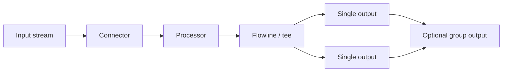

# Channel Routing, Connectors, and Flowlines

`Channel` is the graph-building boundary between discovered input streams and requested output streams. It decides whether a stream can remain passthrough or requires a complex connector and processor.

## Selection model

`Processor::create` selects a passthrough processor, video transcoding processor, Dolby transcoding processor, or standard audio transcoding processor from output stream parameters. `Channel` creates compatible connectors and shares processors/flowlines where outputs can reuse work.

| Path | Main classes | Core purpose |
| --- | --- | --- |
| Passthrough | `PasstroughConnector`, `PassthroughProcessor` | Direct media flow with tee/splitter behavior; captions can receive `utplcaptionmute`. |
| Complex video | `VideoComplexConnector`, `VideoTranscodingProcessor` | Normalize/select video, feed compositor and encoding flowline. |
| Complex audio | `AudioComplexConnector`, `AudioTranscodingProcessor` | Normalize audio, select fallback/mute paths, feed encoding. |
| Dolby | `DolbyComplexConnector`, `DolbyTranscodingProcessor` | Decode/convert/metadata/encode Dolby-capable paths. |

## Flowlines and sharing

`Flowline` creates an `encodebin` and can insert conversion, rate, and caps filters before it. It tees encoded output into queues for downstream outputs. This sharing is why a change to one output may affect another output with compatible requirements; inspect flowline matching before adding a per-output element.

An output of type `mxl` gets a different flowline, `MxlFlowline` (`channel/processor/transcoder/mxlflowline.cpp`), chosen by `createFlowLine` when the stream's codec is `Codec::MXL`. It is an `identity` and a pad on the channel bin, with nothing to encode, and `compatible()` always answers no, so each MXL stream has a flowline of its own (it ends in one flow). Its processor is found like any other: an MXL video of the same size and rate as an on-air output shares that output's canvas, and any other size or rate adds a processor with its own compositor. See [41](41-mxl-integration.md#programme-tap-step-3).

## Media graph shape

## Important constraints

Connectors create request pads, fallback sources, and clock synchronization elements. Do not replace their linking with a simple element chain: live output and missing-stream handling rely on these branches. Verify media type, codec, caps, live status, and output container before assuming a path is reusable.
