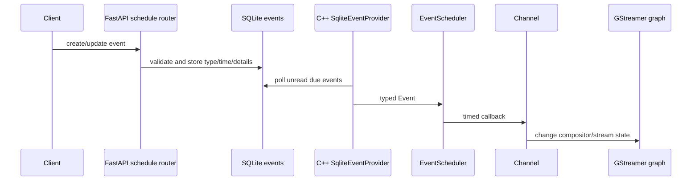

# Events, Overlays, Slates, and Squeeze

## Event path

The database schema has `id`, `type`, `time`, optional `end_time`, JSON `details`, creation time, and read time. The C++ provider parses database records into `EventSqueeze`, `EventOverlay`, `EventSlate`, `EventSpliceInsert`, `EventReturnToNetwork`, or `EventTimeSignal` types.

| Event | Core payload | Scheduler callback source | Lifecycle evidence |
| --- | --- | --- | --- |
| Squeeze | name, duration, source/destination windows, fade values | Compositor | Has start/stop/update/cancel implementation. |
| Overlay | URLs, geometry, opacity, fades, rate, duration | Compositor | Has start/stop/update/cancel implementation; latency TODO remains. |
| Slate | URI and duration | Processor/compositor-related stream work | Start implementation exists; update contains an explicit TODO. |
| Splice insert | event ID and duration | Output | Scheduler event inserts SCTE section; see 16. |
| Time signal | descriptors | Output | Scheduler maps descriptor fields to SCTE output. |
| Return to network | event ID | Output | Scheduler event removes/returns SCTE state. |

`EventScheduler::ScheduledEvent` distinguishes asynchronous start/stop and a `Channel::TimedCallbackSource`. This is important: compositor-affecting events are timed in a different graph position than output SCTE events. Always record the callback source and the observed running-time conversion when debugging an event.

Each event logs `FIRED`/`ENDED` (or `MISSED`) lines at the moments listed in [21](21-logging-observability-and-debugging.md#as-run-event-log).

## Overlay

`EventOverlay` carries image URLs, geometry, opacity, fade-in/out, duration, and delay-between-images. The scheduler's overlay implementation creates image input and compositor layers, applies timed changes, and includes a source comment about observed image/compositor latency. Validate every timing claim against PTS/frame output.

`ImageOverlay.z_order` is optional. The compositor gives the programme layer z-order 100 and normal
overlays 101+, preserving foreground behavior. Explicit values below 100 place a graphic behind the
programme and enable a reveal-style L-band. `Squeeze.fade_in` and `fade_out` now reach the existing
geometry transition machinery through the SQLite provider.

## Slate

`EventSlate` substitutes the whole programme with other media for a duration — not an overlay.
It takes a `url` and a `duration` in milliseconds. **Runtime verified** end to end on a live
SRT input: fired from the operator page, observed on the HLS output, and stopped early.

### The media is fetched over HTTP

`OverlayInput` hands the URI to `cpr`/libcurl and downloads it to a temp file
(`transcoder/lib/utpl/src/utpl/transcoder/input/overlay.cpp`). It does **not** read a path off
disk, so a `file:///media/...` URI of the kind `graphics_catalog.json` uses is not safe to
assume here. The slate catalog therefore serves its media over HTTP from the API itself and
hands the engine an absolute URL back to `127.0.0.1:${API_PORT}`; the engine's own request for
it is visible in the log as `GET /slates/media/{id}`.

### Audio

Slate media with no audio track of its own would otherwise leave the programme audio playing
under a silent card. The slate now claims an audio blank for its duration.

That claim is refcounted rather than a boolean, because audio has more than one reason to be
muted. `Channel::blank()` is the channel-wide blackout (a level), while every transient muter
holds a token; `AudioBlankState::shouldBlank()` ORs them
(`transcoder/lib/utpl/src/utpl/transcoder/channel/audioBlankState.h`). With a single flag, a
slate ending during an SCTE blackout would unmute audio the blackout still wanted silenced —
last writer wins. With tokens, no holder can clear another's reason.

The slate holds a `Channel::AudioBlankHold`, which releases in its destructor, so no code path
can leak a mute. A leaked claim is permanent silence with nothing left to release it. The hold
borrows its channel and must not outlive it; `Engine` guarantees that by declaring `_channel`
before `_scheduler`, and by clearing events in `stop()` while the channel is still up.

Verified on air: an audio-less slate drives the output to -91 dB for its duration and audio
returns cleanly afterwards; two overlapping slates hold silence unbroken when the inner one
ends.

### Cancellation

There is no stop endpoint and none is needed. `DELETE /scheduled_events/{id}` removes the row;
the provider's `isValid()` then returns false and the scheduler cancels the in-progress event
(`event/scheduler.cpp`), which runs the same `handleStop()` as a natural end. The poll is
`EVENT_CHECK_INTERVAL_MS` = 500 ms, so a stop lands within about half a second. Measured: a
40-second slate deleted after 14 seconds held silence for ~12 seconds rather than 40.

## Squeeze

`EventSqueeze` references named predefined squeeze definitions from `transcoder.squeeze`. Each definition uses input and output rectangles. The scheduler modifies compositor geometry for the event duration; tests currently cover Aston-band and L-band scenarios.

## Operational requirements

- Times must be normalized consistently between REST/API, SQLite, scheduler, and GStreamer running time.
- Event overlap, cancellation, restart recovery, and cleanup need explicit tests; do not infer them from the presence of `end_time`.
- Image URLs require network/file access and may use asynchronous preload paths.
- Verify visual changes with extracted frames and verify audio changes independently.

See 16 for SCTE-originated event behavior and 17 for the REST/database contract.

## Operator cue lifecycle and animated-video gate

The catalog now includes Logo and Bug at their old 1920×1080 coordinates, the existing static
L-band/Aston sponsors, and two shortened QTRLE/ARGB MOV assets. Cue records expose `kind`, `mode`,
`phase`, start/end/restore timestamps, and cancellation state. Scheduled, on-air, and restoring
L-band/Aston cues share a database-backed ownership lock; a conflicting request returns 409. Logo
and Bug are independent and may omit duration to hold until Stop.

Static PNG and explicit multi-image inputs retain the existing fully preloaded buffer-list path. A
single source that FFmpeg reports as multi-frame uses a producer thread and condition-variable ring
limited to 96 MiB. The producer blocks when full, announces preload after up to three initial
frames, preserves native frame duration, seeks and flushes at EOF for looping, and wakes/joins on
cancellation. `ENABLE_VIDEO_GRAPHICS` defaults to false, so this build-time implementation is not a
production capability until its alpha, repeated-cancellation, and RSS acceptance gates pass.
