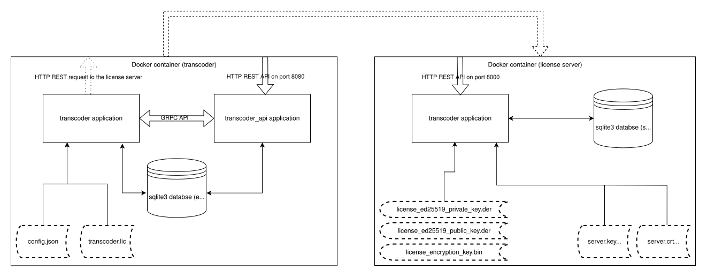

#  UTPL - Universal Transcoding Pipeline Library - High-Level Design Document - Version 1.1.0-beta.2-skandha.3

## 1.0 Introduction

This document introduces gives developers and system maintainers a high level view of UTPL (Universal Transcoding Pipeline Library) including the architecture of UTPL, the flow between components and technologies used in the Skandha Media Services Transcoder solution.

**1.1 Scope**: 

This document limits itself to an 'outside view' intended to be used as a 'first read' before diving deeper into programming or debugging UTPL.

**1.2 Audience**: 

Developers intending to program or add features to UTPL and system maintainers are targeted in this document.

## 2.0 System Overview

OTT platforms need a streaming solution allowing them to control the content streamed over the Internet. UTPL provides such a solution by allowing them to convert live streams acquired from channels into a stream that contains not just the original stream but also includes (but is not limited to) ad breaks, image overlays, slates. These changes in streams are controlled using a web interface. The web interface is served from a centralized server while UTPL runs on Cloud instances or bare metal server maintained by the customer.  

## 3.0 Goals & Objectives: 

UTPL aims to provide a OTT solution that has an intuitive user interface and a high performant Transcoder that is secure and easily managed by the customer and provides maximum uptime of the OTT channel. It strives to support large number of users with delivery of the streams taking place via CDNs.

## 4.0 High-Level Vision:

The bird's eye view of the system includes a centrally maintained web interface (common to all customers) and a Docker container running on a Linux server (specific to a customer and maintained by them). 

The orginal stream is retrieved by the hardware on a server (or cloud intances) of the customer. The original stream is altered by the solution running on the customer's hardware (or cloud instance) and distributed using a Contenet Delivery Network (CDN) (if using HLS)

## 5.0 Architecture Overview

### 5.1 Architecture Diagram (By 7Bulls):

#### 5.1.1 Transcoder Application:
The Transcoder application is one of the 2 applications that are responsible for the encoding and OTT services. Running inside docker container 'skandha-transcoder', its job is the read the incoming stream, transforming it as per the configuration file, modify it (say insert ads) as per the instruction recevied from the user and procude the output stream stream.  
  
The Transcoder application supports the following protocols as input
1. Local File
1. SRT
1. HLS
1. UDP
1. Local Playlist
1. NDI

And the following as output
1. Local File
1. SRT
1. UDP
1. AWS S3 Bucket for HLS
1. HLS

These inputs and outputs are configured using a configuration file (config.json). The configuration file has to be prepared carefully to provide all the details necessary for each protocol. Samples of config.json are present in the repository at *transcoder/config/example*. 

The Transcoder application is coded in C++ and C and utilizes the following libraries: *Python/FastAPI, C++, C, GStreamer (+ MainConcept, Visionular, Dolby Atmos Plugins), FFmpeg, SQLite, TSDuck, OpenSSL, Glib-2.0, gRPC, CURL, Boost, nlohmann/json, spdlog*. 

The Transcoder application communicates with the Transcoder API application over gRPC. It receives instructions from the Transcoder API application to transform the input video stream by inserting Ads (Aston band, L Band, Slate) into video stream. The transcoder reencodes by default, but passthrough connectors and processors are reachable and are selected by configuration. As an outline, this is what the work of the transcoder can be written as:  
take input -> decode to raw -> alter as per live instructions -> encode to output format -> push output

The Transcoder application performs its primary job (re-encoding and transformation of the input video stream) using GStreamer. It utilizes GStreamer's C API wrapped in C++ classes to do so. As a primary requirement, understanding of C++ and GStreamer (in  C) is essential to start development on the Transcoder.

#### 5.1.2 Transcoder API Application:
The Transcoder API application is the 2nd application at the core of the Transcoder solution. Written using FastAPI in Python, it allows the user to trigger various actions i.e. actions taken by the Transcoder on the input video stream. 

As of version 1.1.0-beta.2-skandha.3, these include
  - Insert a Logo (Image Overlay)
  - Inserting a Slate
  - Inserting a L-Band
  - SCTE35 Time Signal
  - SCTE35 Splice Insert
  - SCTE35 Return To Network

The Transcoder API also allows modification of the core file of the Transcoder - config.json, checking Transcoder status and restarting the Transcoder after modification of config.json.

It listens on port 8080 and communicates with the Transcoder using gRPC. To access the API docs, go to **http://(server-ip):8080/docs**. You can also test the API via this interface.

#### 5.1.3 SQLite3 Database
The Transcoder and Transcoder API application also use a sqlite3 database for the storing events to be executed. The database is located at **/opt/utpl/events.sqlite**.

The database contains information about the *id, type, time, end time, details, creation time, read time* of each event. The database is indexed over time, end_time, id and type to allow faster retrieval of events.

#### 5.1.4 Licensing Server
This document contains a brief introduction to the licensing mechanism in the Transcoder. Extensive documentation about the Licensing server is located at **doc/license** in the repository.  

There are two types of licenses: offline and online. An Offline license is to be generated during deployment and does not need a live licensing server to allow the Transcoder to function. The Online license on the other hand requires the licensing server to be accesible as the Transcoder function. The Transcoder API does not need any license. 

### 5.2. Component Diagram

<table style="width:100%;">
  <tbody>
    <tr>
      <td></td>
      <td></td>
      <td></td>
    </tr>
  </tbody>
</table>

## 6. Technology Stack
- Backend: Python/FastAPI, C++, C, GStreamer (+ MainConcept, Visionular, Dolby Atmos Plugins, NDI SDK), FFmpeg, SQLite, TSDuck, OpenSSL, Glib-2.0, gRPC, CURL, Boost, nlohmann/json, spdlog
- Database: SQLite
- Cloud Provider: AWS, GCP
- Development & Deployment: Docker with Ubuntu 24.04 as base image
- SDKs: MainConcept, Visionular, Dolby Atmos Plugins, NDI SDK  
Note: The SDKs are never a part of the Docker image. They are to be installed on the server and provided to the Docker container using mapped volumes.

## 7. Deployment Strategy
The web interface (for controlling the media stream) will be hosted on Skandha Media Service's server. The Docker image that contains UTPL will be hosted on the customer's Cloud Instance or Bare Metal Servers.
For UTPL, a server reasonably powerful will be provided by the customer. The Docker image will be hosted on Cloud Market Places.  
The Docker images can be downloaded from **ghcr.io** after necessary permissions have been granted.

## 8. Assumptions and Constraints
The server or cloud instance running the UTPL Docker image is assumed to be powerful enough to run UTPL. Hardware Encoding of media streams is contingent upon the hardware/cloud instance provided by the customer.

## 9. Glossary
  - UTPL: Universal Transcoding Pipeline Library
  - NDI SDK: Network Device Interface SDK
  - Docker: Docker Community Edition has been used for development
  - Transcoder: Refers to the C++ application that performs the transcoding from the input and provides the output
  - Transcoder API: Refers to the FastAPI application that provides the HTTP interface and communicates with the Transcoder over gRPC

## 10. Workflow of managing the Transcoder & Transcoder API (During Development and Testing)
Folllowing are the steps to be followed to launch the Transcoder Docker Container.

1. The Docker image for the Transcoder is made available to the user. It is installed using docker pull
1. The user pulls the image using the **dokcer pull** command.
1. The Docker container (named *transcoder* or *devel* with the version number as the tag) is started using **docker run**. The configuration file (config.json) and necessary SDKs are mapped for the container using the **-v** option of the docker cli command
1. Inside the Docker container, the transcoder and transcoder_api are started and managed by the **supervisor** program
1. The standard output of these programs is presently printed to the console