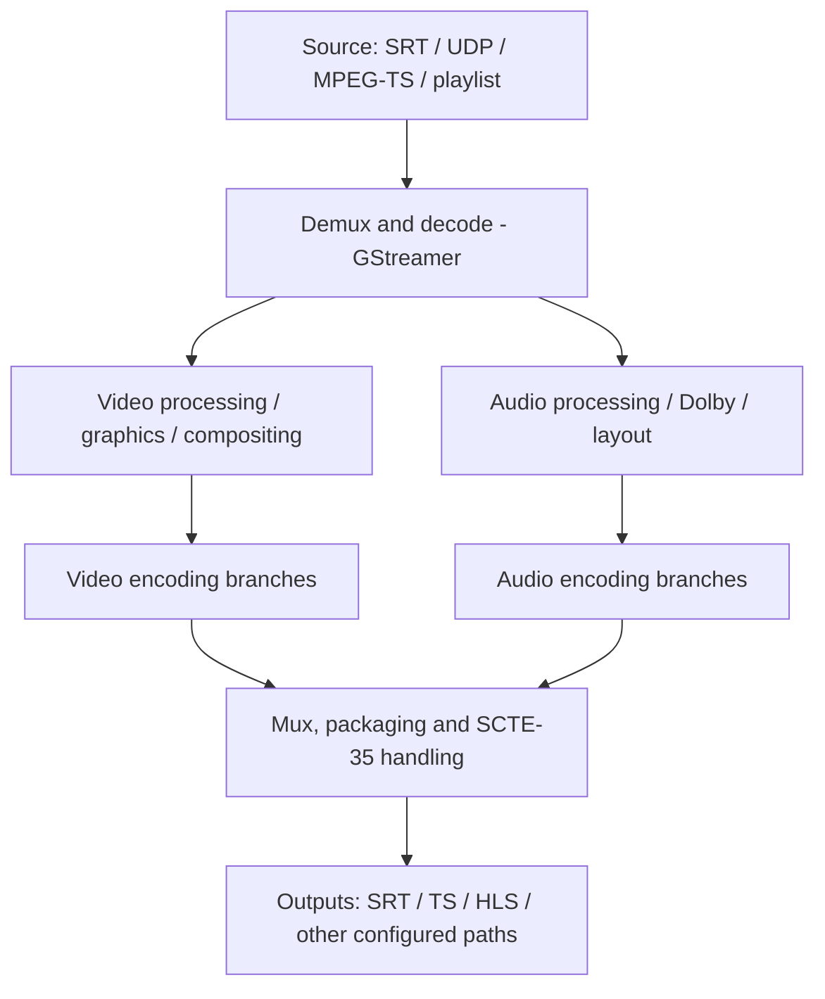
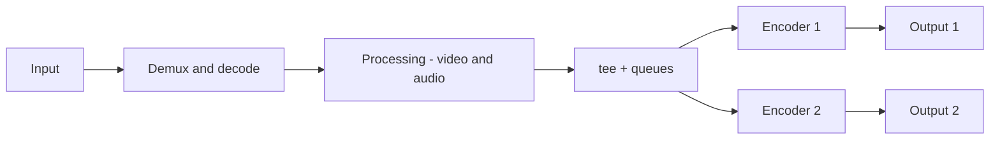
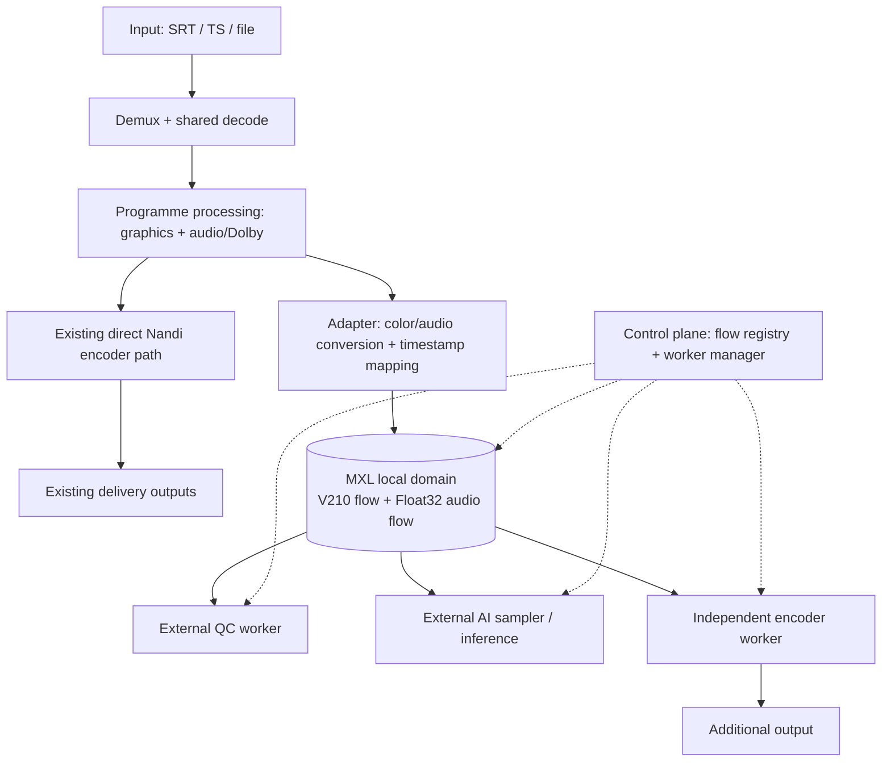
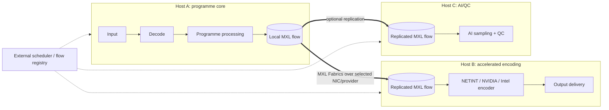

> **Repository note (2026-10-30):** this brief describes Nandi from project discussion. The
> "to verify in Nandi repo" items have since been checked against source in
> [41 MXL integration](../codebase/41-mxl-integration.md), which also corrects the deck's MXL release
> status (v1.1.0 is stable). Read that page before building on this brief.

# PRESENTATION AGENT MASTER BRIEF
## Nandi + Media eXchange Layer (MXL) + MXL Fabrics
### Engineering architecture, integration strategy, performance trade-offs, and proof-of-concept plan

**Document purpose:** This is a self-contained, technical content and production specification for an AI agent tasked with generating a PowerPoint presentation for the Nandi engineering team.

**Audience:** C++/GStreamer engineers, video/audio/broadcast engineers, DevOps/platform engineers, GPU/VPU engineers, QA/SRE, and technical decision-makers at Skandha.

**Research cutoff:** 28 October 2026. Refresh external facts and release statuses when the PPT is generated.

**Terminology:** The intended combination is **Nandi + MXL local shared-memory media exchange + MXL Fabrics inter-host media replication**. The phrase "Media Fabrics" is used informally in conversations; use the official library/product name **MXL Fabrics (`mxl-fabrics`)** in the slides. Do not portray MXL and Fabrics as unrelated rival protocols.

**Required PPT deliverables:**
1. `Nandi_MXL_Fabrics_Technical_Architecture.pptx`, fully editable, widescreen 16:9.
2. A presentation PDF for distribution if the generator supports it.
3. Speaker notes containing reasoning, definitions, important caveats and source links.
4. The final slide must give an explicit proposed engineering decision and phase-gate criteria.
5. Optionally export architecture diagrams as SVG/PNG and a one-page source/claim ledger.

**Scope:** Prepare the presentation; **do not implement or claim to have implemented any Nandi feature**. Do not fabricate internal repo findings, benchmark results, vendor performance, costs, or feature completion.

---

# 1. PRIMARY OBJECTIVE AND CENTRAL THESIS

Make a technical case for and against introducing MXL and MXL Fabrics into Nandi, without overselling them.

**Central thesis:** Nandi could evolve from a mostly self-contained GStreamer transcoder into a media-function platform with a reusable, processed, synchronized video/audio programme. MXL can make **local cross-process uncompressed media reuse** practical; MXL Fabrics can **replicate selected flows across machines**. However, a simple GStreamer `tee` may be the superior solution inside a single pipeline, and raw V210 inter-host transfer may be prohibitively expensive without fast networking. The development strategy should begin with audit/benchmarking and opt-in input/output boundaries, not a rewrite or obligatory distributed architecture.

The presentation must answer all of these questions:
- What does Nandi already do, based on information currently available, and what is unverified?
- What are MXL and MXL Fabrics, exactly? Which features are in the released SDK versus only in documentation/main branch or prototypes?
- Where should MXL sit in a C++17 + GStreamer pipeline? Where should it **not** sit?
- Which consumer patterns are compelling: AI/QC monitoring, external encoding, compositing, graphics, Dolby audio reuse, remote processing, resilience?
- How is shared decoding different from simply introducing MXL?
- What are the costs in pixel conversion, memory bandwidth, copying, timestamps, network bandwidth and complexity?
- How should hardware encoders (NETINT/Intel/NVIDIA/CPU) coexist with a V210, 10-bit 4:2:2 uncompressed MXL boundary?
- How do we preserve multi-audio sync, Dolby output, SCTE-35 semantics, frame pacing, IDR/GOP requirements and live broadcast continuity?
- What experiments and objective acceptance gates decide whether this architecture is worthwhile?
- Which future-looking ideas should **not** be committed to now?

**Core recommendation to present:**
1. Audit and benchmark baseline Nandi before changing boundaries.
2. Build small, optional `mxlsrc` / `mxlsink` video and audio experiments with established GStreamer plugin and/or C API.
3. Establish a shared processed-programme output and two separate consumers, with clear instrumentation.
4. Test independent encoder worker and failure isolation locally.
5. Only then evaluate Fabrics and a remote worker on suitable NICs.
6. Keep the existing Nandi monolith/local pipeline fully supported for normal single-channel and low-resource deployments.

---

# 2. STRICT EVIDENCE, ASSUMPTION, AND QUALITY RULES FOR THE AGENT

## 2.1 Evidence labels (mandatory on technical slides)

Use these labels discreetly in speaker notes or a small source line:

- **VERIFIED EXTERNAL:** backed by an official MXL/EBU/vendor URL, with release/version context.
- **KNOWN FROM PROJECT DISCUSSION:** user-described Nandi behavior; not code-audited.
- **TO VERIFY IN NANDI REPO:** suspected internal behavior, class contracts, copies, caps, timestamps, producer/consumer ownership.
- **PROPOSED DESIGN:** engineering recommendation, not shipped capability.
- **EXPERIMENTAL / POC:** possible but not proven end-to-end.
- **ILLUSTRATIVE CALCULATION:** arithmetic based on declared assumptions, not a measured benchmark.

Never convert project-discussion context into an assertion that code was inspected. If the presentation agent has actual repository access, inspect code before making specific implementation claims and document file paths/commits. Otherwise, clearly display "requires code audit".

## 2.2 Claims that MUST NOT appear

- "MXL eliminates all memory copies" or "MXL Fabrics is always zero-copy." (Fabric provider and memory layout matter; audio may need an extra copy.)
- "MXL is a codec, transport replacement for SRT, or a compressed mezzanine format." (It is an uncompressed media exchange layer.)
- "MXL reduces encoder cost automatically." (It does not reduce the encoding work per output.)
- "NETINT hardware accepts V210 directly" without device/SDK caps verification.
- "MXL natively supports SCTE-35 semantics" without a verified event mapping or external control plane.
- "MXL natively guarantees seamless live failover." (It does not replace stateful encoder/GOP/PTS and mux synchronization.)
- "Inter-host 1080p60 V210 fits on 1 GbE." (It does not.)
- "MXL has built-in access-control orchestration, dynamic resource scheduling, a flow registry or production-grade automatic service failover." (Implement/adopt separately.)
- "Nandi currently duplicates decode" unless verified. A single-pipeline `tee` may already share decoded data.
- "Existing Nandi feature X is production-ready" without independent evidence.
- Fake benchmark charts, speedups, latency figures, savings percentages, power efficiency, hardware pricing, or delivery dates.

## 2.3 Current authoritative public sources (read before composing slides)

Use vendor/project originals, not AI summaries. Put a shortened link/footnote on each claim-heavy slide and detailed URL in notes or sources appendix.

| ID | Source | URL | Use |
|---|---|---|---|
| [S1] | EBU MXL initiative | https://tech.ebu.ch/dmf/mxl | Industry rationale and legitimacy |
| [S2] | EBU Dynamic Media Facility | https://tech.ebu.ch/groups/dynamic-media-facility | DMF goals; distinguish ecosystem vision from SDK features |
| [S3] | MXL project home | https://dmf-mxl.github.io/mxl/main/ | APIs, formats, version context |
| [S4] | MXL architecture | https://dmf-mxl.github.io/mxl/main/Architecture/ | Ring buffers, flow layout, permissions, memory model, media formats |
| [S5] | MXL timing model | https://dmf-mxl.github.io/mxl/main/Timing/ | TAI, PTP epoch, index mapping, clock discipline |
| [S6] | MXL tools/GStreamer examples | https://dmf-mxl.github.io/mxl/main/Tools/ | `mxlsrc`, `mxlsink` and safe pipeline syntax |
| [S7] | MXL Fabrics getting started | https://dmf-mxl.github.io/mxl/main/FabricsGettingStarted/ | TCP, Verbs/RoCE, AWS EFA, shared-memory provider |
| [S8] | MXL Fabrics developer guide | https://dmf-mxl.github.io/mxl/main/FabricsDeveloperGuide/ | APIs, remote write, target info exchange, progress model, copies |
| [S9] | MXL official releases | https://github.com/dmf-mxl/mxl/releases | Check version/release status; v1.1.0 adds Fabrics and GStreamer plugin |
| [S10] | MXL C API usage | https://dmf-mxl.github.io/mxl/main/Usage/ | Instance, readers, writers, grains/samples |
| [S11] | MXL event flows docs | https://dmf-mxl.github.io/mxl/main/event-flows/ | Future timed-event possibilities; re-check whether feature is released |
| [S12] | MXL GitHub | https://github.com/dmf-mxl/mxl | API headers and open issues |
| [S13] | NETINT GStreamer plugins | https://github.com/NETINT-Technologies/netint_gst_plugins | Optional VPU backend, not an MXL requirement |
| [S14] | NETINT installation guide | https://docs.netint.com/vpu/quadra/documentation/quadra-installation-guide/quadra-installation/linux-host/public-repos-installation/install-gstreamer/ | Hardware plugin compatibility and inspection |

**Release verification note:** MXL v1.1.0 release notes identify `mxl-fabrics`, `gst-mxl-rs`, and multi-flow reader synchronization. The agent must verify if a newer stable release exists before finalizing, and clearly label main-branch features that are not in its chosen release tag. [S9]

## 2.4 Slide claims audit

Before final export, build a source/claim ledger for at least 15 specific claims: claim, source URL, verified date, exact version, and category (verified/project-discussion/proposed/illustrative). Keep slides concise but notes thorough.

---

# 3. NANDI BASELINE: WHAT THE AGENT MAY SAY

## 3.1 Context supplied through project discussions (not independently audited)

- Nandi is a **C++17 transcoding/playout application** built around **GStreamer 1.0**, with additional FFmpeg libraries, UTPL and other dependencies.
- Input paths discussed include SRT, UDP/MPEG-TS, live/network sources, and file/playlist operations; verify the exact supported input/output matrix in source code before marking each format as shipping.
- Input decode/demux handling has included `decodebin` and dynamic `pad-added` callbacks; one previously mentioned method is `SingleInput::_createDemuxer`.
- The programme can perform video processing/compositing/branding and audio processing including Dolby SDK integration, upmix/loudness/channel configuration. Verify exact deployed features.
- SCTE-35 is an important Nandi workflow. A discussed implementation converts cue information into HLS tags including CUE_OUT/CUE_IN. SCTE timestamps/durations often use the 90 kHz MPEG timebase. Verify when/how they are transformed before assuming continuity.
- Multiple audio entries can represent parallel deliverables (e.g., 5.1 AC-3 and stereo encodings), rather than a single switched audio track.
- Inputs, programme processing, encoding, muxing, output delivery and status/configuration currently have application-level orchestration.
- A working design for **Level 1 MXL input** and **Level 2 raw MXL output** has been discussed; these are planned, not proven shipped. Proposed output needs V210, 32-bit Float audio, fractional frame rates, stable stored UUIDs, and flow names/NMOS tags.
- A channel can be containerized and restarted via UI in the broader AWS service direction; do not assume the production orchestration is fully deployed or that its feature set is identical to core Nandi.

## 3.2 Repository inspection checklist, if repo becomes available

Have the agent discover these code areas rather than infer:
1. Input ownership: number of decoders per input/channel/output; where sharing already occurs.
2. GStreamer DAG topology: `decodebin`, `tee`, `queue`, `multiqueue`, `appsink`, `appsrc`, encoder branches, on-demand pipeline changes.
3. `GstCaps`, `GstVideoInfo`, `GstAudioInfo`, hardware memory types (`memory:NVMM`, `CUDAMemory`, VAAPI/DMABuf, CPU-host) and colorimetry handling.
4. `GstBuffer` copy/map/writable operations; system-memory round trips around compose/encode.
5. Audio pad layout, Dolby plugin ordering, raw versus compressed audio, clock selection, resampling and latency reporting.
6. Frame-rate representation (including 30000/1001, 60000/1001), 1080i progressive handling and field-order metadata.
7. Timestamp flow: `PTS`, `DTS`, duration, `GstSegment`, running time, wallclock/TAI, discontinuities and new-segment handling.
8. SCTE-35 representation and preservation across input→decode→output (and playout transitions), including timebase conversion and ad markers.
9. Error recovery: decoder/encoder exceptions, resource release, input reconnect, crash/restart, health checks.
10. Config schema, API/UI route, runtime restart behavior, plugin discovery and option validation.
11. Encoders available: software and hardware; actual session limits and caps, not marketing numbers.
12. CPU/GPU/VPU load, frame copy counts, buffers and drop statistics already collected.
13. Docker configuration, `/dev/shm`, mounts, processes/users, NIC access, cgroups and device nodes.
14. Existing flow identity persistence, NMOS/resource model, and worker orchestration.
15. Security/isolation controls for per-tenant media and codec resources.

## 3.3 Baseline technical diagram (conceptual only)



Label diagram: **"Conceptual architecture inferred from discussions; exact code topology requires audit."**

---

# 4. TECHNICAL FOUNDATIONS TO EXPLAIN CORRECTLY

## 4.1 What MXL is

MXL stands for **Media eXchange Layer**. It is an open source interoperable exchange layer for **uncompressed** media between media functions, generally using memory-mapped, tmpfs-backed ring buffers on a shared host. It offers a writer/reader flow model. Separate containers/processes with appropriate domain access can share a flow without introducing a new compressed transport or custom packetization. [S3, S4]

Core data and timing concepts:
- A **flow** has identity and metadata; its media is represented in bounded circular storage.
- **Discrete grains** suit video and ancillary data; **continuous sample rings** suit audio.
- Video `video/v210` is uncompressed **10-bit 4:2:2**, and `video/v210a` is a fill/key variant. Verify current release/caps/constraints. [S4]
- Audio `audio/float32` is 32-bit floating-point PCM; channels are represented in channel-oriented sample regions internally; adapters may expose ordinary interleaved GStreamer PCM at the plugin boundary. [S4, S6]
- Ancillary `video/smpte291` is an ANC payload format. **SMPTE 291 ancillary data is not SCTE-35 by itself.** [S4]
- MXL represents time using a TAI timeline based on the SMPTE ST 2059-1 epoch; it **does not require PTP specifically** on a single host, though cross-host clock discipline matters. [S5]
- MXL's ring is finite history, **not a multi-hour DVR/replay service**.
- Reader slowness may cause overrun and missed grains; noncritical consumers must not backpressure Nandi's critical output without an explicit policy.
- Local read/write permissions derive in part from UNIX filesystem access, and the reader may use read-only memory maps. [S4]

## 4.2 What MXL Fabrics is

`mxl-fabrics` extends media flow replication **across hosts**. The current library uses libfabric/OFI and interfaces/providers such as Linux TCP, RDMA Verbs, AWS EFA and shared memory. A Fabric **target** exposes memory for a flow, while an **initiator** transmits/replicates data. Target information (addresses and memory keys) must be exchanged out of band and protected. [S7, S8]

Important implementation caveats:
- Prefer remote-write when supported; provider-specific fallback/capabilities, buffer alignment, completion/progress and message size matter.
- MXL Fabrics does not by itself discover Nandi workers, authorize flows, provision networks, optimize placements or select the best transport.
- Multiple remote subscribers may imply replicated network bytes per target; evaluate real fanout/network behavior.
- Remote-write does not mean every transform is zero-copy end-to-end. The current docs note an extra target-side copy in certain continuous/audio paths. [S8]
- It does not magically convert a 10 GbE NIC into a raw 4K60 link, or make WAN usage economical.

## 4.3 What GStreamer already provides

For elements within the same process/pipeline, GStreamer `tee` + `queue` can split a decoded media stream with shared `GstBuffer` references. It may be lower latency and complexity than writing/reading an MXL flow. A `tee` still needs queueing, synchronization, caps negotiation, and allocation handling. Identify when buffers become writable/copy-on-write or require hardware download.

Comparison matrix (include early in deck):

| Feature | GStreamer `tee` | MXL Flow API | MXL Fabrics |
|---|---|---|---|
| Natural scope | Same GStreamer pipeline | Multiple local processes/containers | Separate hosts |
| Primary data movement | Shared buffer references where possible | mmap shared-media rings | Network/provider-mediated replication |
| Uncompressed video support | Negotiated GStreamer formats | Standard constrained formats (e.g. V210) | Replicates compatible MXL flows |
| Codec work eliminated? | Only if duplicate decode was otherwise needed | Only if consumers reuse already-decoded media | Only if remote consumers reuse it |
| Timing complexity | GStreamer clock/segments | PTS ↔ MXL/TAI mapping | Additional cross-host clock discipline |
| Likely overhead | Lowest within pipeline | Conversion/ring/write/read/lifecycle | All local costs + network/replication |
| Best use | ABR branches, local splitting | External local tools, isolated workers | Specialized remote workers where worth network cost |

## 4.4 What MXL does NOT do

- It does not encode/decode video or audio by itself.
- It does not replace SRT/UDP/HLS/TS ingest and delivery, or customer-facing distribution.
- It does not define Dolby workflow, playout schedule, ad decisioning or MPEG-TS mux semantics.
- It does not guarantee 4:2:2 fidelity through 4:2:0 hardware encoders.
- It does not solve tenant isolation, flow naming, worker lifecycle, telemetry, or failover orchestration without surrounding software.

---

# 5. TARGET ARCHITECTURES TO ILLUSTRATE

The deck should show **at least four architectures**, with distinct line styles: solid = proposed media path, dashed = control/metadata, dotted = optional.

## 5.1 A: Baseline local Nandi with no MXL (reference and fallback)



**Engineering question:** If Nandi already does this efficiently, how much incremental benefit is available from MXL for standard ABR?

## 5.2 B: One local MXL programme with external consumers



**Design principle:** The main Nandi output path continues even when optional MXL consumers are down. If MXL publication failure is catastrophic for a particular contract, make that a configurable policy, not the global default.

**Checkpoint distinction:** one flow near decode can expose a clean source; one near final programme can expose branded/composited/Dolby-processed media. Do not assume we need both for all channels—each raw flow costs RAM and potentially conversion.

## 5.3 C: Distributed Nandi worker with MXL Fabrics



**Key warning in slide:** At 1080p60 V210, *one* raw video flow is about 2.65 Gb/s of payload. Remote transport must earn its cost. A compressed contribution format may be more appropriate for remote server placement.

## 5.4 D: Hybrid, placement-aware architecture (recommended north star)

```mermaid
flowchart TB
  SRC[Source] --> CORE[Nandi ingest / core processing]
  CORE --> LOCAL[Local GStreamer tee]
  LOCAL --> HW[Local hardware encoders]
  LOCAL --> MP[MXL programme publishing - opt in]
  MP --> EXT[Local external consumers]
  MP -.-> FAB[MXL Fabrics when justified]
  FAB -.-> REM[Remote specialist worker]
  CORE --> META[Timed event / SCTE-35 control path]
  META -.-> HW
  META -.-> REM
  MON[Observability + worker lifecycle] -.-> CORE
  MON -.-> MP
  MON -.-> REM
```



**Recommendation:** Favor direct GStreamer branches for tightly coupled low-latency work, local MXL for process isolation/interoperability and selective Fabric boundaries where specialized processing is worth the raw-network cost.

---
# 6. TECHNICAL DEEP DIVES REQUIRED IN THE PRESENTATION

## 6.1 Video data path, conversions and hardware offload

Show **three paths** and explicitly distinguish copies/conversions:

**Path 1: local GStreamer only**
`Decoder output (negotiated caps/memory) -> processing -> tee -> encoders`

**Path 2: local MXL**
`Decoder/process output -> ensure progressive video + V210 packing (possibly copy) -> MXL ring -> mxlsrc -> convert to encoder native caps (possibly another copy) -> encoder`

**Path 3: remote Fabric**
`Decoder/process output -> pack for MXL -> origin MXL -> libfabric replication -> target MXL -> format conversion/upload to hardware -> encoder`

Explain:
- The 10-bit 4:2:2 MXL media format does not mean a 4:2:0 hardware output retains 4:2:2 chroma.
- Progressive-only V210 constraints require a deinterlacing policy for 1080i input. Interlaced fidelity/timing is a separate engineering decision; never imply support that has not been validated.
- GPU/VPU memory may need downloading, conversion and uploading when interfacing with CPU mapped rings. A device-memory capability in a library does not prove interoperability with every GPU driver or accelerator.
- Every format negotiation must account for width/height, stride, colorimetry, range, framerate, bit-depth, chroma siting, interlace, timestamp/duration and orientation.
- Hardware encoder API support is device-specific. For NETINT, inspect `gst-inspect-1.0 niquadra`, encoder sink caps, `libxcoder` SDK compatibility and actual device model; do not assert that NETINT directly ingests V210. [S13, S14]
- Dolby audio paths may remain in Nandi while independent external video encoders use MXL; synchronizing chosen audio flow with encoded video remains essential.

### Suggested caps illustration (not a tested Nandi pipeline)

```bash
# Official MXL tools documentation includes variants of the following pattern.
# Verify element properties and codec capabilities in the installed version.
gst-launch-1.0 \
  videotestsrc is-live=true do-timestamp=true ! \
  videoconvert ! \
  video/x-raw,format=v210,width=1920,height=1080,framerate=30000/1001 ! \
  queue ! mxlsink flow-id=<PERSISTED_UUID> domain=/dev/shm

# Separate process reads the local media flow.
gst-launch-1.0 \
  mxlsrc video-flow-id=<PERSISTED_UUID> domain=/dev/shm ! \
  videoconvert ! queue ! fakesink sync=true
```

**CAUTION:** Placeholders are not executable as-is; actual MXL flow creation and plugin behavior are version-dependent. Use official executable examples in [S6] for any live demo. Document that separate audio and video flows are involved rather than assuming one A/V multiplexed flow.

## 6.2 End-to-end media clock and timebase mapping

Include a timeline diagram containing:
- Ingest clock (e.g., source PCR/PTS, input RTP timestamp, playout clock).
- `GstClock`, buffer `PTS`/`DTS`/duration, `GstSegment` running time.
- Map to MXL's TAI/SMPTE-2059-epoch grain index.
- Flow IDs and grain timestamp indexes preserved through Fabric replication.
- Downstream encoder PTS and mux clocks.
- SCTE-35 cues in 90 kHz timebase mapped to the output timeline.

**Timing discussion points:**
1. Fractional rates (30000/1001, 60000/1001) must be represented without cumulative integer rounding/drift.
2. Live discontinuities, late source packet arrival, gap, repeats, buffer overruns, seek/playlist transitions and input restarts need explicit policy.
3. Audio drift management may require resampling/slip, not just matching a nominal sample rate.
4. NTP can suffice for appropriately configured single-host workflows; MXL does not mandate PTP, but stable multi-host clock frequency and reliable cross-host discipline are critical. [S5]
5. MXL does not automatically compensate for jitter/latency; the adapter must handle origin timestamp and buffering decisions. [S5]
6. Every checkpoint in the architecture should preserve correlation metadata for provenance and troubleshooting.

**Proposed `MediaClockAdapter` contract:**
`{source_timebase, source_pts, duration, segment_epoch, discontinuity_id, origin_time_tai_ns, rational_frame_rate, flow_id}`; convert back with a per-flow monotonic mapping and validation tests.

## 6.3 Audio and Dolby

- Identify original audio, 2-channel downmix, 5.1 Dolby-processed audio, loudness-controlled audio and language-specific streams as separate, **named** flows if needed.
- Discuss Float32 PCM on MXL and preservation of channel labels/order, sample rate, clock origin, sample indices and audio gain.
- Distinguish raw MXL PCM from AC-3 / E-AC-3 / other encoded outputs.
- Keep proprietary Dolby SDK licensing and compliance inside licensed Nandi processing unless a formal deployment/legal review approves service separation.
- Use the Jio mixed stereo/5.1 programme case as a **discussion-derived example** of why dynamic channel detection and audio continuity matter; not necessary to quote project-specific failure rates.
- Required QA: audio-to-video sync, channels 1..8 or other selected layouts, clipping, silence transitions, Dolby metadata, language switching and restart recovery.

## 6.4 SCTE-35 and time-aligned events

Propose an internal canonical `TimedMediaEvent` model with fields such as:
`event_id`, `source_id`, `source_timebase`, `source_pts`, `event_type`, `splice_direction`, `duration`, `segmentation_type`, `segmentation_upid`, `origin_tai_ns`, `output_mapping`, `status`.

Responsibilities:
- Input ingest parser normalizes SCTE events.
- Nandi's control path keeps events in a source or programme timeline.
- Output adapters translate events into the correct carrier: MPEG-TS in-band signaling, HLS playlist tags, DASH events if implemented, or application-specific metadata.
- External event/AI consumers may propose events but do not silently become authoritative ad decision engines.
- A sidecar event stream, message broker or future MXL event-flow mapping may synchronize independent workers; verify maturity/release scope of MXL event-flow API. [S11]
- **Do not treat SMPTE 291 ANC directly as SCTE-35** or imply that encoding an event into MXL automatically preserves it across MPEG-TS muxing.
- Required QA: pre-roll, late cues, overlap, duplicate cues, mismatched 90k vs ns timescales, discontinuity, output restarts, ad break duration and IDR/splice alignment.

## 6.5 Process isolation, lifecycle, API and flow registry

Suggested opt-in components (new proposals, not existing code):

| Proposed component | API/owner responsibility | Inputs/outputs | Failure policy |
|---|---|---|---|
| `MxlInputSource` | GStreamer `mxlsrc` or C API wrapping; caps/timing validation | MXL video/audio -> Gst pads | Mark source unavailable, reconnect/backoff |
| `MxlOutputSink` | GStreamer `mxlsink` or C API; copy/convert accounting | Gst pads -> named MXL flows | Optional branch can drop/disconnect without killing on-air path |
| `MediaFlowRegistry` | Persisted UUIDs, source/programme relationships, selected profiles and ACL groups | Logical flow config -> identifiers/metadata | Reconcile crashed writer, refuse ID collision |
| `MediaClockAdapter` | Rational timebases and discontinuity mapping | Gst PTS <-> TAI/grain | Reject or label invalid alignment |
| `FabricBridge` | Target/initiator, provider selection, credentials/key exchange, replication | MXL flow -> remote MXL flow | Retry or switch provider per policy |
| `WorkerManager` | Process/container lifecycle and resource quotas | Flow config + workload -> worker | Restart worker without mutating upstream media |
| `MetricsCollector` | Per-channel/flow/worker dashboards and alerts | Counters, latency, resource use | Never block critical media path |

**Minimum flow registry fields:** `channel_id`, `programme_id`, `flow_id`, `flow_type`, `format`, `width`, `height`, `frame_rate_num/den`, `sample_rate`, `channel_map`, `origin_clock`, `domain_path`, `producer`, `consumer_permissions`, `buffer_history_ms`, `owner_lease`, `lifecycle_state`, `created_at`, `last_heartbeat`, `configuration_version`.

**Ownership model:** one writer per flow; readers many; create/edit/delete guarded by registry and filesystem controls; use deterministic persisted UUIDs per intended logical output, with explicit versioning for incompatible format changes.

## 6.6 Security, container and multi-tenant considerations

- Bind mount MXL domains intentionally; do not expose `/dev/shm` to unrelated containers by default.
- Use UNIX user/group and directory permissions; read-only mounts for consumers where practical. [S4]
- Separate customer/tenant domains. Flow metadata and media are sensitive; avoid accidentally crossing tenant boundaries.
- Define memory limits, directory cleanup, crash recovery, stale-flow GC and per-channel quotas.
- Verify that a Docker container's default `/dev/shm` allocation is sufficient; set explicit tmpfs/shm sizing based on measured load.
- Do not expose Fabric target information (remote addresses, memory keys) over unprotected channels. Use authenticated signaling and restricted network reachability. [S7, S8]
- RDMA is not inherently a complete security model. Design NIC/RDMA access controls and infrastructure policies.
- Formalize encrypted transport and cross-tenant access requirements separately; do not assume the Fabric data plane provides TLS or mutual authentication.
- Capture supply-chain issues: SDK pinning, checksums, license review (MXL repository states Apache-2.0), CI SBOM scanning and update cadence.

## 6.7 Availability and recovery

Distinguish three scenarios:

| Failure | What survives | What does not automatically recover |
|---|---|---|
| Optional QC/AI worker crashes | Existing direct Nandi live path | QC continuity, event backlog |
| Independent encoder worker crashes | Nandi programme publisher and MXL ring | Encoded stream continuity, bitrate/GOP state, downstream client session |
| Host running programme core fails | Nothing on that host | Requires independent/replicated ingest and processing; Fabric alone not enough |

Show output resume steps: detect failure -> choose standby -> attach to compatible flow -> establish aligned PTS & IDR -> recreate audio mux states/counters -> switch output -> measure gap and alert. A "hot standby" is a **proposal requiring state machine and test**, not a native guarantee from MXL.

## 6.8 Observability and operational ownership

Mandatory per-flow telemetry: media grain FPS, producer progress/head index, reader lag, overrun count, dropped/repeated frames, buffer history, flow age, last write/read, PTS↔TAI mapping errors, audio drift and peaks, format caps, memory usage, fanout count.

Mandatory Fabric metrics: provider, NIC/link, completed/failed transfers, bytes/sec, p50/p95/p99 replication latency, congestion/retry, target availability, queue/completion depth, CPU/NUMA locality.

Mandatory Nandi/encoder metrics: encoder FPS/sessions, CPU/GPU/VPU utilization, VRAM, frame copy/mapping cost, end-to-end latency, per-output missing frames, PCR/PTS continuity, IDR/GOP alignment, AAC/AC-3 issues, SCTE marker correctness.

Suggested tooling examples (not mandatory stack): Prometheus metrics exporter, Grafana dashboards, OpenTelemetry traces where appropriate, GStreamer `GST_DEBUG` and tracers, `perf`, eBPF profilers, `pidstat`, `nvidia-smi`, vendor VPU utilization tools, `ethtool`, `rdma`, `ibstat`, `sar`, `iperf3`. Validate tool availability before promising specific metrics.

---

# 7. BANDWIDTH, RAM, AND EFFICIENCY CALCULATIONS

The presentation MUST include a **visible numerical cost model**. It should not be all diagrams and marketing claims.

## 7.1 Formulas

For the usual V210 packing at widths divisible by 48 (e.g. 1920 and 3840):

```text
V210 bytes per line = ceil(width / 48) * 128
Frame bytes = V210 bytes per line * height
Raw video B/s = Frame bytes * frame_rate
Raw video Gb/s = Raw video B/s * 8 / 1e9
Ring payload bytes ≈ Frame bytes * ceil(frame_rate * history_seconds)
               (+ writer-reserved grains, metadata, allocation/stride overhead)
Float32 PCM audio bytes/sec = sample_rate * channel_count * 4
Network payload Gbps ≈ Raw video Gbps * copies_per_remote_destination
```

Check V210 row alignment/stride in the target implementation; these are nominal examples, not guarantees of the actual memory allocator or wire overhead. Ignore blanking, packet headers, VLAN/ethernet/PCIe overhead, ANC and retransmission in raw payload figures.

## 7.2 Illustrative uncompressed V210 rates

| Format | Nominal frame size | Payload MB/s | Video Gb/s | 100ms video payload ring (approx.) |
|---|---:|---:|---:|---:|
| 1280x720 @ 60 | 2.49 MB | 149.30 | 1.19 | 14.93 MB (6 frames) |
| 1920x1080 @ 30 | 5.53 MB | 165.89 | 1.33 | 16.59 MB (3 frames) |
| 1920x1080 @ 60 | 5.53 MB | 331.78 | 2.65 | 33.18 MB (6 frames) |
| 3840x2160 @ 30 | 22.12 MB | 663.55 | 5.31 | 66.36 MB (3 frames) |
| 3840x2160 @ 60 | 22.12 MB | 1327.10 | 10.62 | 132.71 MB (6 frames) |

**Agent validation instruction:** Recompute values independently before publishing, especially row alignment for 1280-pixel V210 video. Example exact payloads: 720p60 = 2,488,320 B/frame = 149.2992 MB/s = 1.194 Gb/s; 1080p60 = 5,529,600 B/frame = 331.776 MB/s = 2.654 Gb/s; 2160p60 = 22,118,400 B/frame = 1327.104 MB/s = 10.617 Gb/s. These calculations exclude allocator and network overhead.

For 1920x1080 @ 60 fps, *N* remote copies require approximately:

| Concurrent flow copies | Video payload network Gb/s |
|---|---:|
| 1 | 2.65 |
| 2 | 5.31 |
| 4 | 10.62 |
| 8 | 21.23 |
| 16 | 42.47 |

For a six-channel, 48 kHz Float32 PCM flow: `48000 * 6 * 4 = 1,152,000 B/s`, ~9.22 Mb/s, before overhead. This is much smaller than one V210 video flow, though audio synchronization still matters.

A link rate is not useful throughput. Do **not** claim an absolute maximum channel count from these ratios without measuring real framing overhead, concurrent users, traffic shaping, CPU/NIC performance and desired headroom. Use a *budget* and sensitivity analysis instead.

## 7.3 Break-even model

Define the two compared solutions:

**Baseline:** `N` independent workloads, potentially re-ingesting/decoding. Total resource consumption includes duplicate decode + each consumer's processing. This scenario only applies if actual duplication exists.

**Proposed:** one decode + MXL conversion/publication + shared consumers + consumer-side conversion. Add Fabric cost for remote consumers.

A high-level inequality for "beneficial" local sharing is:

```text
Avoided duplicate decoding and ingest cost
    > MXL publisher conversion + memory-copy cost
      + reader reconversion + lifecycle/monitoring overhead
```

For remote sharing, also add:

```text
Fabric transfer + network provision cost + failure-domain cost
```

Benchmarks must report whether the baseline already shares decoding with `tee`, and compare *end-to-end outputs* for equivalent quality, not isolated microbenchmarks.

---

# 8. SCENARIOS TO EVALUATE AND PRIORITIZE

Use the following cases to connect architecture to value. Make sure "value" and "efficiency mechanism" are separate columns.

| Scenario | Why it matters | How MXL helps | What it cannot save | Feasibility/priority |
|---|---|---|---|---|
| Source ingest shared by transcoder + QC + AI | Avoid duplicate source connections/decode | One published local decoded source | AI inference and its own preprocessing | Near term, high if duplicate decode verified |
| Completed programme shared with external encoder | Isolate encoder crashes/upgrade separately | Reuse processed raw frames/audio | Encoding work and caps conversion | Near term prototype |
| Independent ABR encoders inside one process | Multiple renditions | Usually no MXL required; use `tee` | Each encode/scaler | First compare baseline |
| Audio mix/loudness output reuse | Consistency and less duplicate Dolby work | Float PCM flow shared with authorized processors | Dolby license, resampling and encoded audio | Medium |
| Live QC pre/post processing | Better fault localization | MXL checkpoints | Analysis compute | High |
| Externally generated fill/key graphics | Modular graphics suppliers | V210A may exchange fill/key | Composition/GPU work | Later, verify caps |
| Remote VPU encoder farm | Heterogeneous compute | Fabrics replicates selected programme | Network bandwidth, encoder work | Conditional, higher effort |
| Remote AI inference | Flexible GPU placement | Shared media to specialist node | Network cost; heavy raw transfer | Prefer downsample/compressed derivative when enough |
| Encoder standby/failover | Service resilience | Secondary worker can attach to programme | Seamless output failover state | Later, requires state machine |
| Sports highlight/replay pipeline | New product feature | Timed checkpoints feed clip-recorder | Rolling durable storage and clip indexing | Later |
| SCTE-35 metadata distribution | Event consistency across outputs | Proposed event/control sidecar | Timed cue translation and QA | High, not automatically native |
| Dynamic compute scheduling | Maximize hardware utilization | Separate workers + selected Fabric boundaries | Control plane scheduling | Long-term exploration |

Prioritize by estimated ROI, integration effort, isolation gain, network penalty, and testability. Do not include unjustified dollar savings or fixed project dates.

---
# 9. FULL SLIDE-BY-SLIDE STORYBOARD

Produce **36 primary slides plus 8 optional technical appendix slides**. If time/space is constrained, keep all main conclusions and move deep implementation details into notes/appendices; never omit the baseline-versus-MXL comparison, timing model, throughput costs, risks, or evaluation decision.

Each storyboard entry below specifies:
- **Slide headline:** Prefer an argument/insight rather than a generic topic label.
- **On-screen:** Facts/visual elements actually visible.
- **Diagram/data:** Required visual, preferably editable.
- **Speaker notes:** Deep explanation that the technical presenter can use verbally.
- **Guardrail:** What not to overclaim or gloss over.

## Section I: context and engineering problem (slides 1-6)

### Slide 01 — Title / project framing
**Headline:** `Nandi + MXL + MXL Fabrics: From a Transcoder to a Reusable Media-Processing Platform?`
- **On-screen:** Nandi, MXL Flow API, MXL Fabrics; internal technical architecture review; research as of 28 Oct 2026.
- **Visual:** Simple source -> programme processing -> local shared flows -> optional local/remote workers line-art.
- **Notes:** The question mark is deliberate: this is an engineering exploration, not a commitment to distribute everything.
- **Guardrail:** No fake logo, maturity rating or customer endorsement.

### Slide 02 — Executive technical answer
**Headline:** `Adopt MXL selectively; do not replace the core GStreamer pipeline.`
- **On-screen:** 4 takeaways: audit first; GStreamer `tee` inside the pipeline; MXL across local process boundaries; Fabrics only when bandwidth and isolation justify it.
- **Visual:** Decision ladder `GStreamer -> MXL -> Fabrics` with boundary/benefit labels.
- **Notes:** State primary POC and its go/no-go measurement plan. This should be a technical answer, not executive marketing.

### Slide 03 — Questions we intend to settle
**Headline:** `The design is only valuable if it improves measurable system behavior.`
- **On-screen:** Decoder duplication? output failure isolation? reusable raw programme? hardware placement? live latency? bandwidth/format costs?
- **Visual:** Six engineering questions arranged around throughput/latency/reliability triangle.
- **Notes:** Explain each question is testable and distinguish Nandi repo audit from externally verified SDK facts.

### Slide 04 — What Nandi does today (our current understanding)
**Headline:** `Nandi already owns ingest, processing, audio, timing and multiple outputs.`
- **On-screen:** Conceptual DAG of input, decode/demux, video compose, Dolby audio, encode/mux, output, SCTE handling.
- **Visual:** Current architecture flowchart from section 3.3.
- **Notes:** Mention C++17, GStreamer 1.0, previously discussed `decodebin`/`pad-added`, SCTE-35 and Dolby. Cite discussion as context, not code inspection.
- **Guardrail:** Explicit caption **"Based on project discussions; source-level verification pending."**

### Slide 05 — Where Nandi could have duplicated work
**Headline:** `Repeated ingest and decode are the potential savings—not MXL itself.`
- **On-screen:** Pattern A: three independent tools each subscribe/decode; Pattern B: one decode publishes media once. List cases where no duplication exists.
- **Visual:** side-by-side before/after with 3 decoder blocks versus 1.
- **Notes:** If Nandi already shares decode for its own ABR branches, sharing with *external* QC/AI is the likely new gain.
- **Guardrail:** Use conditional "could", not "currently does" unless measured.

### Slide 06 — Existing alternatives must be included
**Headline:** `A GStreamer tee may already solve the cheapest version of the problem.`
- **On-screen:** `tee + queue` vs `MXL` vs `Fabrics` comparison matrix from section 4.3.
- **Visual:** Three columns showing in-process, local cross-process, cross-host.
- **Notes:** Explain memory ownership, caps, process failure isolation and fanout costs.

## Section II: MXL and Fabrics principles (slides 7-13)

### Slide 07 — MXL explained at engineer level
**Headline:** `MXL is an uncompressed, timed, shared-media interface.`
- **On-screen:** MXL domain, flow identity, reader/writer, discrete grain, continuous samples, bounded ring.
- **Visual:** simple timeline of 5 numbered circular frame buffers and two readers.
- **Notes:** Explain memory-mapped tmpfs, reader/writer not TCP socket per local consumer, bounded history and overwrite behavior. [S3, S4]

### Slide 08 — MXL memory and format contract
**Headline:** `The media format constraint creates both interoperability and conversion cost.`
- **On-screen:** V210 = 10-bit 4:2:2 raw; V210A = fill/key; Float32 PCM audio; SMPTE 291 ANC; reference to progressive/frame constraints.
- **Visual:** video grain / channel-planar audio ring schematic.
- **Notes:** Explain why a 4:2:0 accelerator could need convert-in/convert-out, not lossless after encoding.
- **Guardrail:** Don't imply Dolby bitstreams are Float PCM, or that all AV formats work without conversion. [S4]

### Slide 09 — How MXL flows are accessed
**Headline:** `Flow creation, commit and consumption are explicit and must be managed.`
- **On-screen:** writer creates flow -> opens grain -> writes -> commits -> readers access; lifecycle and stale writer recovery.
- **Visual:** sequence diagram (writer, flow registry, mapped ring, Reader 1, Reader 2).
- **Notes:** Name C API `mxlCreateInstance`, `mxlCreateFlowWriter`, `mxlCreateFlowReader`, grain/sample API. The SDK does not provide the proposed Nandi registry by itself. [S10]

### Slide 10 — What released GStreamer integration offers
**Headline:** `gst-mxl-rs supplies a practical bridge without a custom media transport plugin.`
- **On-screen:** `mxlsink` writes buffers; `mxlsrc` reads flows; display official video/audio pipeline snippets.
- **Visual:** `GstPipeline A -> mxlsink -> /dev/shm MXL -> mxlsrc -> GstPipeline B`.
- **Notes:** Verify installed plugin version, exact caps and property names against [S6]. Explain C API alternative for precise flow handling. [S9]

### Slide 11 — Timing is the hardest correctness boundary
**Headline:** `PTS, TAI grain indices and output timestamps must describe the same media moment.`
- **On-screen:** source clock -> GStreamer PTS/running time -> MXL TAI -> downstream PTS; 30000/1001 rational rate.
- **Visual:** four synchronized timelines and an example discontinuity.
- **Notes:** MXL bases indexing on SMPTE-2059 epoch without requiring a PTP source per se; clock drift, playlist switching and source timestamp loss require explicit policy. [S5]

### Slide 12 — MXL Fabrics explained
**Headline:** `Fabrics moves selected MXL flows between hosts through libfabric providers.`
- **On-screen:** target/initiator, out-of-band TargetInfo, supported providers TCP / Verbs / EFA / SHM, remote-write capabilities.
- **Visual:** two hosts with local MXL rings and NIC transport; control path drawn dashed.
- **Notes:** It replicates data; it is not a scheduler, service mesh, multicast routing product, or failover manager. [S7, S8]

### Slide 13 — Hardware and network reality
**Headline:** `Raw programme distribution only makes sense where the network budget works.`
- **On-screen:** V210 1080p60 ~2.65 Gb/s, UHD60 ~10.62 Gb/s; 1/10/25/100GbE conceptual capacity tiers.
- **Visual:** bandwidth bars and NIC examples; no "streams per NIC" promise.
- **Notes:** The link-rate capacity is not usable throughput; traffic headroom, copies per consumer, protocol overhead and jitter matter.

## Section III: proposed Nandi boundaries (slides 14-21)

### Slide 14 — Architecture choices side by side
**Headline:** `Four placements are possible; the hybrid boundary is the practical default.`
- **On-screen:** A local monolith; B local shared programme; C distributed fabric; D hybrid.
- **Visual:** 4 thumbnail schematics with boundary color key.
- **Notes:** Hybrid retains a direct low-latency output path and shares media selectively.

### Slide 15 — Proposed Nandi integration points
**Headline:** `Add MXL at stable source/programme boundaries, not everywhere.`
- **On-screen:** checkpoint 1 raw decoded source, checkpoint 2 post-processing programme, audio processed variants, metadata control path.
- **Visual:** Nandi main DAG with optional taps marked; direct path remains solid.
- **Notes:** Compare pre- and post-compositing value; publisher is opt-in and potentially asynchronous.

### Slide 16 — Local multi-consumer workflows
**Headline:** `One decode can serve QC, sampled AI and an external encoder.`
- **On-screen:** Shared programme fanout to AI sampler, QC, separate encoder, preview.
- **Visual:** Local MXL ring hub with reader boxes; AI sampler explicitly reduces resolution/FPS.
- **Notes:** No implication that every AI model consumes full 60fps 4:2:2 raw frames; illustrate sampling services and inference ownership.

### Slide 17 — Live QC before and after processing
**Headline:** `Two checkpoints make faults easier to localize.`
- **On-screen:** before processing -> after processing -> after encoding comparison; defects and likely owners.
- **Visual:** QC decision tree: source defect vs processing defect vs encoding/delivery defect.
- **Notes:** Example incidents: source freeze, missing graphics, silent surround output, missing SCTE marker. No claim of currently automated diagnostics.

### Slide 18 — Decouple encoder workers carefully
**Headline:** `A failed external encoder need not take programme processing down.`
- **On-screen:** Nandi programme publisher -> MXL -> Encoder A/B/C; worker restart and backpressure rules.
- **Visual:** multiworker diagram with fault containment outline.
- **Notes:** Outputs can be independently restarted, but player continuity is not automatic; GOP/IDR, clocks and mux state must be rebuilt.

### Slide 19 — Hardware encoding with MXL
**Headline:** `MXL is accelerator-neutral but pixel-format interoperability is not free.`
- **On-screen:** software/GStreamer, NETINT Quadra, NVIDIA NVENC, Intel QSV/VAAPI backend candidates; format conversion/memory flow.
- **Visual:** V210 ring -> format/transfer adapter -> accelerator native surface -> encoder -> delivery.
- **Notes:** NETINT SDK/GStreamer compatibility is hardware-version-specific; codec capacity marketing ≠ Nandi performance. MXL does not accelerate the encoder. [S13, S14]

### Slide 20 — Reuse processed Dolby audio correctly
**Headline:** `Share the processed PCM once; preserve language, channel order and sync.`
- **On-screen:** original / stereo / 5.1 / language variants; Float32 flow; encoded audio remains downstream.
- **Visual:** audio branch with named channel maps and sync markers.
- **Notes:** Include audio drift, 48 kHz sample clock, layout changes, silence transitions, licensing and multi-audio SCTE continuity.

### Slide 21 — Graphics, fill/key and external functions
**Headline:** `V210A could enable modular live graphics—but it is a later experiment.`
- **On-screen:** external CG engine -> fill/key V210A flow -> Nandi composition -> programme output.
- **Visual:** fill/key layering schematic.
- **Notes:** Verify format/plugin caps, alpha interpretation and timing. Do not treat graphics flow as a ready-made Nandi feature. [S4]

## Section IV: metadata, systems and failure behavior (slides 22-28)

### Slide 22 — SCTE-35 cannot be an afterthought
**Headline:** `A shared raw programme needs a parallel, authoritative timed-event plane.`
- **On-screen:** cue parse -> normalize -> time-map -> output-specific MPEG-TS/HLS adapters; sidecar proposals.
- **Visual:** media plane and metadata/control plane running in parallel.
- **Notes:** MXL ANC vs SCTE-35 distinction. Event flows are interesting but pin current maturity. [S11]

### Slide 23 — Flow identities and discovery
**Headline:** `Stable UUIDs, lifecycle ownership and authorization must live outside the raw data plane.`
- **On-screen:** `programme_id`, `flow_id`, `flow_type`, caps, clock, producer, allowed consumers, lease/TTL, status.
- **Visual:** registry table with source flow and processed-programme flow connected to workers.
- **Notes:** Discuss persistence, collision prevention, stale flow GC and NMOS resource metadata integration.

### Slide 24 — Container architecture and isolation
**Headline:** `Shared media requires deliberate shared-memory and permissions design.`
- **On-screen:** separate processes/containers, read-only consumers, domain permissions, explicit tmpfs memory quotas.
- **Visual:** host with 4 containers and one deliberately mounted domain.
- **Notes:** Avoid shared IPC/process namespaces assumptions; MXL memory maps work with appropriate mounts. [S4]

### Slide 25 — Cross-host architecture
**Headline:** `Fabric replication enables placement flexibility at the price of raw network traffic.`
- **On-screen:** Host A core, Host B VPU encoding, Host C AI/QC, control plane; provider selection constraints.
- **Visual:** section 5.3 distributed architecture, with media throughput labels.
- **Notes:** Discuss when compressed SRT/other transport beats raw MXL; TCP used for functional prototyping, Verbs/EFA where relevant.

### Slide 26 — Failure domains and recovery
**Headline:** `Worker isolation helps, but seamless failover requires deliberate state recovery.`
- **On-screen:** 3 failure scenarios, what survives, what is lost, time to detect and rejoin.
- **Visual:** fault table + failure timeline.
- **Notes:** Distinguish encoder worker crash from main programme host crash; need independent ingest and failover for full HA.

### Slide 27 — Observability and troubleshooting
**Headline:** `We need to see the cost of every boundary.`
- **On-screen:** CPU; memory bandwidth; `GstBuffer` copies; frame drops; audio drift; VPU/GPU; Fabric p95/p99; output PTS/SCTE correctness.
- **Visual:** layered metric dashboard mockup, no invented figures.
- **Notes:** Proposed instrumentation points and tracing IDs across channel/flow/worker.

### Slide 28 — Security and production hardening
**Headline:** `Media domains and remote-memory keys are sensitive infrastructure.`
- **On-screen:** UNIX ACL / mounted domains / multi-tenancy / authenticated TargetInfo exchange / network segmentation / SBOM.
- **Visual:** trust-boundary diagram local and remote.
- **Notes:** Do not assume libfabric's transport is encrypted; require security review before exposing remote memory.

## Section V: economics and controlled validation (slides 29-34)

### Slide 29 — Bandwidth and ring-memory model
**Headline:** `Raw 4K60 video can exceed a 10GbE link before any replication overhead.`
- **On-screen:** corrected V210 bandwidth table from section 7, frame/ring formulas and one audio example.
- **Visual:** scale bars 720p60, 1080p60, UHD60.
- **Notes:** Explain base-10 MB, stride rounding, memory allocation and the distinction between payload and real wire throughput.

### Slide 30 — Fanout cost and scaling limit
**Headline:** `The consumer count multiplies bandwidth only when we replicate across a boundary.`
- **On-screen:** 1/2/4/8/16 remote 1080p60 copies and Gb/s; local readers do not each imply full independent network transfers.
- **Visual:** simple bar chart; compare with 10/25/100GbE lines without treating those lines as usable ceilings.
- **Notes:** Talk about NIC fanout, CPU/GPU/NIC placement, NUMA, PCIe, memory bandwidth and burst jitter.

### Slide 31 — Performance comparison framework
**Headline:** `Four equivalent builds tell us whether any new boundary is worthwhile.`
- **On-screen:** Test A existing Nandi; B optimized local `tee`; C local MXL+workers; D Fabric+remote worker.
- **Visual:** 4-column experiment matrix with independent variables and expected changes.
- **Notes:** Keep same source, output codecs, bitrates, audio layout, graphics, cue cadence and workload to ensure valid comparisons.

### Slide 32 — POC design (minimal reproducible experiment)
**Headline:** `Start with one input, two raw checkpoints and two external consumers.`
- **On-screen:** 1080p live input -> decoded source checkpoint, processed programme checkpoint; external QC and independent encoder.
- **Visual:** detailed local POC workflow with instrumentation labels.
- **Notes:** Start with reference-generated bars/audio and controlled files before difficult live feeds. Explain fallback on the direct Nandi output.

### Slide 33 — POC success/failure gates
**Headline:** `Promote MXL only if the measured trade-off is acceptable.`
- **On-screen:** Correctness, continuity, synchronization, fault isolation, CPU/RAM/latency, audio/SCTE, ops/security; numeric targets proposed and to be agreed before testing.
- **Visual:** green/yellow/red rubric with blank target/observed fields (do not invent observations).
- **Notes:** See detailed test matrix in section 10; direct path must not regress. No blanket guarantee of zero drops under impossible overload.

### Slide 34 — Risks and mitigations
**Headline:** `Most risks are at the boundaries, not in the idea of sharing frames.`
- **On-screen:** severity x likelihood matrix for pixel conversion, time mapping, memory, plugin/version, slow readers, Fabric congestion, secure access, SCTE, GPU download.
- **Visual:** risk register with owner/mitigation/verification column.
- **Notes:** Separate risks inherent in raw sharing from risks introduced by distributing workers.

## Section VI: roadmap and decision (slides 35-36)

### Slide 35 — Phase-gated engineering roadmap
**Headline:** `Keep migration incremental and reversible.`
- **On-screen:** Phase 0 baseline audit; Phase 1 MXL local in/out; Phase 2 optional consumers; Phase 3 encoder worker; Phase 4 Fabric experiment; Phase 5 broader orchestration only if proven.
- **Visual:** phase-gate ladder with deliverable and exit gate per phase.
- **Notes:** Do not use fabricated calendar durations. Owner roles can be suggested (GStreamer, audio, platform, QA) but no individual assigned without authorization.

### Slide 36 — Decision and next engineering actions
**Headline:** `Approve a measured local MXL POC; defer mandatory Fabrics and microservice rewrite.`
- **On-screen:** Proposed decision, minimum environment, benchmark sign-off, open architecture questions, next engineering evidence required.
- **Visual:** concise decision table: **Do now / Prove next / Defer / Reject for now**.
- **Notes:** Close with "MXL is a boundary/interface choice, not a universal optimization."

## Optional technical appendix (slides A1-A8)

### A1 — MXL API sequence and pseudo-code
- Instance create, `mxlCreateFlowWriter`, `mxlCreateFlowReader`, open/commit/get grain or sample, teardown.
- Add a note about RAII in C++ wrappers, cancellation, deadlines, ownership and wrong-flow detection.

### A2 — Proposed C++/GStreamer adapter interfaces
- `MxlInputSource`, `MxlOutputSink`, `MediaClockAdapter`, `MediaFlowRegistry`, `FabricBridge` responsibilities.
- Include illustrative schemas only, not fabricated code from Nandi.

### A3 — GStreamer caps and memory boundaries
- V210 progressive -> video converter -> supported encoder caps; Dolby raw audio -> Float32 PCM; device memory and DMA-BUF compatibility investigation.

### A4 — Detailed timing examples
- Grain index mapping for 30000/1001, replay/discontinuity, PCR vs PTS, NTP/PTP trade-offs.
- Include unit test vectors and what constitutes a failed mapping.

### A5 — MXL Fabrics handshake and progress model
- Target exposes flow; TargetInfo shared out-of-band; initiator attaches; progress/commit; receiver reads; cleanup/reconnect.
- Cite [S8]. Do not paste unverified production-level code.

### A6 — Resilience state machine
- Worker NEW -> READY -> ACTIVE -> DEGRADED -> RECONNECTING -> FAILED -> CLEANED; route output only when PTS/IDR/audio valid.

### A7 — Detailed benchmark report template
- Source encoding, output specs, GPU/VPU type, NIC, kernel, GStreamer, MXL tag, measured p95/p99, 1/2/4/8/16 channels, passes/fails.

### A8 — References, external releases and unresolved decisions
- Full sources [S1-S14], dated retrieval, version pin; separate outstanding internal code-audit questions.

---
# 10. EXPERIMENTAL PROGRAM AND ACCEPTANCE CRITERIA

## 10.1 Test configurations

| Test ID | Description | Goal | Key dependency |
|---|---|---|---|
| T0 | Existing Nandi, current outputs | Baseline resource and output quality | Reproducible code, build and source |
| T1 | Existing Nandi with audited decode sharing / `tee` | Isolate cheapest pipeline optimization | Accurate actual GStreamer graph |
| T2 | Standalone MXL `mxlsink` -> `mxlsrc` reference tests | Validate SDK/plugin, video/audio, timing | Pinned MXL tag, known GStreamer |
| T3 | Nandi publishes local source checkpoint | Test input decode reuse and format conversion cost | MXL output adapter |
| T4 | Nandi publishes processed programme checkpoint | Test full raw programme fidelity | Video + processed audio + clock mapping |
| T5 | One QC process + one independent encoder consuming MXL | Test fanout/isolation | Registry + process lifecycle |
| T6 | Restart independent consumer while on-air output continues | Test fault containment | Restart and reattach policy |
| T7 | Simulate slow reader / ring buffer overrun | Test behavior under backpressure | Ring capacity configurable |
| T8 | Playlist/source discontinuity and 30000/1001 | Verify timestamp semantics | Clock adapter |
| T9 | Mixed stereo/5.1 changes, multi-audio | Verify audio mapping and sync | Dolby QA fixtures |
| T10 | SCTE-35 cue timing while worker restarts | Verify event/output alignment | Timed event model |
| T11 | Remote Fabric TCP and then RDMA-capable provider | Compare overhead with raw flow size | NICs, libfabric, topology |
| T12 | Encoder worker on NETINT/NVIDIA/Intel | Quantify hardware format/memory transfers | Actual cards/SDK versions |
| T13 | Multi-channel soak and resource contention | Throughput limit and steady state | Sufficient source generation and monitoring |
| T14 | Host/core failure drill | Reveal limitation of Fabric-only replication | Independent host paths |
| T15 | Security permission and tenant isolation tests | Prevent unauthorized flow access | UNIX groups, mounts, network policy |

## 10.2 Workload matrix

Run at least:
- **Resolutions/framerates:** 720p30, 1080p30, 1080p60, 1080p59.94, UHD30; UHD60 only if hardware/network makes sense; include 1080i input converted according to declared deinterlace policy.
- **Codecs:** H.264, HEVC, and AV1 only when supported by the tested actual encoder; uncompressed MXL V210 is the intermediary.
- **Audio:** mono/stereo/5.1 where supported; Float32 PCM to MXL; representative Dolby-derived programme; constant and changing channel activity; different audio languages.
- **Inputs:** deterministic color bars and audio tone, pre-recorded test segment with known PTS, controlled SRT jitter/loss source, representative live MPEG-TS.
- **Outputs:** at least two simultaneous encodes; one existing on-air output path; MPEG-TS/SRT and HLS when supported by the tested build.
- **Consumer modes:** zero readers, 1, 2, 4 local readers; one remote reader; slow and misbehaving readers.
- **Channel counts:** 1, 2, 4, 8 and more only when supported by host capacity; record exact fail threshold rather than extrapolating.
- **Duration:** functional short runs, an overnight or 24-hour soak, then longer production-like tests if justified.

## 10.3 Mandatory measured outputs

| Metric | Unit | Why it matters |
|---|---|---|
| Ingest-to-output latency | ms, p50/p95/p99 | Live programme responsiveness |
| Local MXL publish/consume latency | us/ms, p50/p95/p99 | Cost of extra boundary |
| Fabric origin-to-target delay | ms, p50/p95/p99 | Remote live viability |
| Output frame drops/repeats | number and rate | Correctness under load |
| Input decode instances | count, with pipeline proof | Genuine reuse benefit |
| CPU usage / thread count | %, cores | Host efficiency |
| Host RAM, tmpfs and memory bandwidth | GB, GB/s | Hidden raw-media cost |
| GPU/VPU utilization and memory | %, VRAM MB/GB | Accelerator headroom |
| Total raw network traffic | Gb/s (per NIC and flow) | Fabric viability |
| Audio-video offset/drift | ms over time | Sync quality |
| Output bitrate, frame size and quality metric | Mbps, PSNR/VMAF where appropriate | Apples-to-apples output quality |
| SCTE-35 cue accuracy | missed/late/duplicate and timeline error | Broadcast correctness |
| Worker restart time and output gap | ms/s | Failure isolation effectiveness |
| Power draw | W, if instrumentation exists | Cost-per-stream comparison |
| Source/network reconnect behavior | attempts/recovery gap | Operational resilience |

## 10.4 Proposed acceptance gates (team to finalize before test)

These are **proposed criteria**, not promises or externally sourced requirements. The engineering team should set numeric limits based on real Nandi service-level targets.

**Gate A: correctness**
- Output matches baseline codec/profile/resolution/bitrate/audio metadata within declared test tolerances.
- Fractional frame rates remain stable; no unexplained long-term audio drift or timestamp regressions.
- SCTE events occur at correct mapped programme time, without unexplained misses/duplicates.
- Format/color range/chroma behavior is explicitly documented; any conversion-related quality changes are measured.

**Gate B: isolation**
- A QC/AI reader crash does not terminate a critical direct Nandi output path.
- An MXL publisher error does not silently corrupt or stall a critical output; policy determines fail-open or fail-closed.
- Stale flow/worker cleanup works without removing active producer media.

**Gate C: efficiency**
- When duplicate decoding exists, show that the avoided decode expense is greater than the new conversion/copy/transport expense at comparable output quality.
- When duplicate decoding does not exist, demonstrate a non-performance benefit such as external-process interoperability, crash isolation or new integrations and quantify its operating cost.
- Report p50/p95/p99, not only mean latency; show peak RAM and steady-state memory bandwidth.

**Gate D: operations**
- Reproducible container deployment, known plugin versions, permission controls, flow registry and per-channel resource budgeting.
- Instrumentation and logs expose format mismatches, ring overruns, slow readers, clock offset and Fabric congestion.
- A documented rollback to standard Nandi exists.

**Gate E: Fabric qualification**
- The remote topology satisfies the workload's bandwidth budget with operational headroom.
- The selected provider and NIC meet latency and stability expectations under interference traffic.
- Security team approves cross-host target-info exchange and host isolation.
- If raw Fabric is slower/more expensive than a compressed contribution path for a use case, reject Fabric for that placement.

## 10.5 Failure injection plan

- Kill producer at a random frame boundary; ensure readers recognize stale producer and do not mistakenly consume stale media indefinitely.
- Stop/restart decoder with same flow ID; verify discontinuity handling.
- Pause an external reader until its ring history is exceeded; verify drop/recovery and alert.
- Exhaust `/dev/shm` or cgroup RAM limit safely in a test environment; confirm failure localization and cleanup.
- Fill NIC to near saturation; measure frame losses, jitter and replication lag.
- Temporarily block Fabric transport, then restore; validate reconnection and policy.
- Force wrong format/caps/flow ID/clock mapping; errors should be explicit and observable.
- Change 30fps to 30000/1001 or input resolution; verify flow compatibility/versioning strategy.
- Insert SCTE-35 events during encoder restart and source continuity changes.
- Restore Nandi direct path while all optional consumers are unavailable.

---

# 11. PROPOSED IMPLEMENTATION WORKSTREAMS (BACKLOG FOR ENGINEERING DISCUSSION)

These are work packages a tech lead may turn into tickets. The slide deck should not suggest they are already assigned or committed.

**WS-00 — Baseline and repository mapping**
- Export GStreamer pipeline diagrams; record all input/decoder/output branches and buffer/caps changes.
- Benchmark existing channels for CPU/encoder load, memory, bandwidth and latency.
- Document current audio/SCTE mapping, output restart and failure behavior.
- Deliverable: "as-is architecture and measured bottlenecks".

**WS-01 — MXL SDK qualification**
- Pin a stable MXL tag and GStreamer plugin; build reproducible Debian/Ubuntu container or native dev environment.
- Validate V210 video + Float32 audio + 30000/1001 with `mxlsrc`/`mxlsink`.
- Test ring history sizes, storage path, caps and plugin teardown.
- Deliverable: reference video/audio flow exchange with timing measurements.

**WS-02 — Nandi input integration**
- Add optional input config type `mxl` without changing normal network-file ingest defaults.
- Implement flow resolution, metadata/format validation, clock mapping, reconnect, domain permissions and output negotiation.
- Integrate with existing `decodebin` path or bypass decoding for already-raw input as needed; avoid unnecessary encode/decode loops.
- Deliverable: Nandi can consume an external compatible MXL video/audio flow.

**WS-03 — Nandi output/checkpoint integration**
- Build optional raw MXL publisher near decoder or post-programme processing stages.
- Add format conversion path, consistent flow identity and per-flow metrics.
- Ensure publisher faults do not stall default on-air outputs.
- Deliverable: independently readable programme flow without modifying the core final encoder.

**WS-04 — Audio clock and channel integration**
- Map Dolby-processed PCM to Float32; preserve channel maps and selected sample rate.
- Align audio/video flow timestamps and handle source layout changes.
- Deliverable: externally consumed audio in sync with video under normal and discontinuity tests.

**WS-05 — Independent consumers/encoder worker**
- Implement prototype QC consumer and sampled AI reader with independent lifecycles.
- Build an encoder worker that consumes MXL, picks tested hardware/software backend, and produces output while respecting timebase and GOP requirements.
- Deliverable: independent worker can be restarted without killing the programme publisher.

**WS-06 — Metadata and SCTE**
- Propose a typed `TimedMediaEvent` model and authoritative translation outputs.
- Validate source cue timing and output presentation after worker changes; document how cues travel to external encoders/muxers.
- Deliverable: end-to-end SCTE cue audit harness; do not make a production assumption about MXL event flows until verified.

**WS-07 — Registry, orchestration and observability**
- Persist flow UUID/config, enforce one-writer policy, reader permission groups, cleanup and metrics.
- Basic process management can be existing systemd/Docker mechanisms; do not require Kubernetes for the POC.
- Deliverable: repeatable start/stop/restart and flow health UI/API.

**WS-08 — MXL Fabrics experiment (later)**
- Qualify libfabric on two hosts over TCP for correctness, then Verbs/EFA with supported hardware where available.
- Test remote-copy cost versus compressed SRT/other contribution, including network contention.
- Validate TargetInfo security, clock synchronization and failure handling.
- Deliverable: measured go/no-go conclusion per topology.

**WS-09 — Accelerators and production optimization**
- Compare CPU vs actual NETINT/NVIDIA/Intel hardware, using equal media content and output profiles.
- Audit zero-copy claims with real buffer tracing; measure CPU copies and conversions.
- Deliverable: backend-specific caps/copy matrix and throughput-per-watt assessment where instrumented.

---

# 12. ENGINEERING DECISIONS THE TEAM NEEDS TO MAKE

Include these questions near the end of the deck or in a workshop annex:

1. Which Nandi consumers really need raw uncompressed video instead of a compressed SRT contribution feed?
2. Which pipeline points are stable, reusable boundaries: source-decode, post-composite, post-audio-Dolby, pre-encoder or post-encoder?
3. Does Nandi already share decoders and buffer references across ABR outputs? If yes, are external consumers the primary need?
4. Should the MXL producer be part of Nandi's process or a sidecar consuming `appsink`/other transport?
5. Is V210 conversion acceptable for all sources, especially 1080i, 4:2:0-only, UHD and GPU surfaces?
6. What is the canonical audio channel map and clock for a programme with mixed stereo and 5.1 content?
7. Where is the canonical SCTE event timeline managed, and how does an independent worker receive it?
8. Should consumer failure be fail-open or fail-closed per output type/customer service?
9. Who owns flow identity, stale producer cleanup, access policy and storage quotas?
10. What is the lowest-latency necessary path? Should it bypass MXL entirely?
11. Which hosts have 25/100GbE NICs, RDMA capability, NUMA alignment and sufficient host RAM bandwidth?
12. Is an inter-host raw flow economically justified versus compressed contribution with additional decode?
13. Do independently managed encoders create significant operational value before a full distributed scheduler exists?
14. What does seamless output failover mean contractually: zero packet gap, no player stall or automatic recoverability?
15. How do we compare resource efficiency: CPU/core, VPU slot, total node power, total cost or channel count at defined quality?
16. Which MXL release and vendor SDK versions are pinned, and who owns ongoing compatibility/security updates?
17. Would a generic internal media-flow bus become a supported product/API or remain an implementation detail?
18. What is the condition to stop the project if MXL adds overhead without user-visible or operational value?

---

# 13. PRESENTATION PRODUCTION AND DESIGN SPECIFICATION

## 13.1 Visual style

- **Format:** PowerPoint 16:9, 1920x1080-equivalent composition, editable shapes/text rather than screenshots where possible.
- **Tone:** Engineering architecture review, not investor pitch. Clear technical vocabulary; define specialized terms once; avoid buzzword padding.
- **Palette:** Neutral charcoal/off-white, 1 main accent for local MXL (blue/teal), 1 separate accent for Fabric network (amber/purple), muted grey for baseline/GStreamer. Consistency matters more than exact shades.
- **Visual language:** Diagram-heavy, labeled arrows, explicit boundaries, notes for codec, timestamps, copy, network and control plane.
- **Legibility:** Titles ~26-32 pt; body ~18-24 pt; tables sometimes ~14-16 pt; notes/source footers smaller but readable. Adjust for actual layout.
- **Text density:** Aim 3-5 bullets per main slide, not 2 pages of prose squeezed into a slide. Put depth in speaker notes and appendices.
- **Icons:** Native vector icons (server, NIC, container, GStreamer pipeline, audio, codec, frame, clock, warning), no unrelated stock photography.
- **Code:** Show short pseudo-code/`gst-launch` snippets only in appendix or selective slides; use monospace and color/line break formatting.
- **Captions:** Every chart has units, assumptions and a note "illustrative calculation" or "measured data" as appropriate.

## 13.2 Diagram grammar and semantics

- **Solid arrow:** media path actually in selected conceptual design.
- **Dashed arrow:** control, metadata, registry or lifecycle.
- **Dotted arrow:** optional/future extension.
- **Thick arrow with Gb/s label:** uncompressed inter-host payload.
- **Blue/teal box:** MXL local memory domain/flow.
- **Amber/purple link:** MXL Fabrics network replication.
- **Grey box:** existing Nandi code/function (discussion-derived until audited).
- **Green box:** external downstream media worker.
- **Red callout:** risk/unsupported claim/required verification.

Ensure diagrams convey separate video/audio/time/event paths without clutter. Use a legend on architecture diagrams.

## 13.3 Recommended charts and tables

1. Architecture before and after with explicit decode count scenarios.
2. Component placement matrix: GStreamer tee vs MXL vs Fabrics.
3. Flow/video/audio ring representation.
4. Bandwidth and memory tables with correct units, no fabricated utilization.
5. Network payload bar chart by remote consumer count.
6. Risk matrix (impact, likelihood qualitative, evidence gap).
7. POC A/B/C/D measurement template.
8. Phase gates with actual conditions rather than arbitrary date estimates.

## 13.4 Speaker-note requirements

Write at least one substantive paragraph per main slide explaining the technology, engineering rationale, limits and presenter talking points. When an external fact is referenced, include source IDs/URLs in notes. For proposed diagrams, say "proposed". Anticipate technical questions: "Why not tee?", "Is it zero copy?", "What is the network cost?", "What happens to SCTE?", "How does Dolby stay in sync?", "How can the worker rejoin after crash?".

## 13.5 Quality assurance checklist

Before delivering PPT:
- [ ] All 36 main slides and expected appendices exist, or reduced slide count is justified with equivalent coverage.
- [ ] Source lines and notes are included and links valid at final generation time.
- [ ] No line overflow, clipped diagrams, tiny footnotes, unreadable chart labels or arrows overlapping titles.
- [ ] Architecture arrows accurately distinguish raw media vs encoded output vs event/control plane.
- [ ] Baseline Nandi description is qualified as discussion-derived if code not audited.
- [ ] All MXL release statements pinned to a released version or labeled main-branch/experimental.
- [ ] All illustrated numbers independently recalculated, with MB vs MiB and Gb/s vs GB/s distinguished.
- [ ] No fictitious measured speedups, raw-stream counts per NIC, NETINT throughput figures or GPU copy guarantees.
- [ ] No claim of SCTE-native compatibility or seamless failover without validation.
- [ ] Explicit GStreamer `tee` alternative and why sometimes superior.
- [ ] Explicit network constraints that can make Fabric **worse** than an ordinary compressed stream.
- [ ] Diagrams are technically coherent: source/audio/video flow pairing and clocks shown.
- [ ] Nandi's default output path survives optional consumer failure in conceptual design.
- [ ] Decision slide gives tangible next action and exit conditions.
- [ ] If PPT generation tools allow, render slides to images and visually review every slide before delivery.

---

# 14. AN AGENT-READY INSTRUCTION TO PASTE INTO A PRESENTATION GENERATOR

> You are the senior media-systems architect and PowerPoint author for an internal Skandha technical team review. Create a complete, technically rigorous editable 16:9 PowerPoint named `Nandi_MXL_Fabrics_Technical_Architecture.pptx` using this entire Markdown specification as the authoritative project brief. Build 36 main slides plus up to 8 appendices, preserving the numbered storyline; condense only if the same technical reasoning survives. Render **architecture diagrams, memory/flow diagrams, clocks, media vs metadata/control planes, buffer-copy boundaries, NIC throughput budgets, failure scenarios, and POC test matrices** as primary visuals. Use the precise distinction between GStreamer tee (in-process), MXL local memory exchange (cross-process), and MXL Fabrics (inter-host). Treat Nandi's described architecture as discussion-derived until its actual repository is inspected. Treat source-backed MXL behavior as externally verified only for the cited SDK/release. Never fabricate benchmarks, numerical gains, release capabilities, source-file claims or delivery dates. Include sources in notes and footers, provide speaker notes for every main slide, and end with the measured local-MXL-POC recommendation and Fabric go/no-go criteria. Build usable slides for a senior C++/broadcast/GStreamer engineering audience, not an executive marketing deck. If you have browser access, verify the latest stable MXL SDK and official docs first. If you have Nandi source-code access, inspect its actual pipeline and update all project-specific diagrams accordingly, reporting any changed assumption. Export the PPTX and (if supported) PDF; visually inspect and correct formatting before delivering.

---

# 15. SHORT PRESENTER SCRIPT / MESSAGING PRIORITIES

**Opening (roughly 45 seconds):**
"Nandi already performs the difficult media work: ingesting, synchronizing, processing, encoding and delivering programmes. The opportunity is to reuse those media results in external applications without forcing every application to rebuild ingest and decoding. MXL is a local shared-media boundary; Fabrics can extend that boundary across hosts. But none of this automatically beats a well-built GStreamer tee, and raw video can be extremely expensive to move. So this review is about where boundaries actually make sense."

**Central engineering argument:**
"We should isolate processes where that improves interoperability or fault containment. We should keep ultra-low-latency, tightly coupled functions together. Our primary question is not 'can MXL run?', but 'when does measured shared-media reuse offset its conversion, timing and network costs?'"

**Closing (roughly 45 seconds):**
"The actionable outcome is a reversible POC: measure baseline Nandi, prove V210/Float32 audio + timing through local MXL, attach independent QC and encoder workers, test process failure without disturbing on-air output, and quantify overhead. We decide about remote Fabric only after we understand network costs and validate a reason to move raw media between hosts."

---

# 16. SOURCE AND CLAIM LEDGER SEED

The slide agent should validate and extend this table and annotate the slide notes. Date-of-access should be updated during generation.

| Claim | Status | Source |
|---|---|---|
| MXL is an open-source local shared-media exchange SDK | VERIFIED EXTERNAL | [S3], [S4] |
| MXL uses reader/writer flow model and memory-mapped ring buffers | VERIFIED EXTERNAL | [S4] |
| MXL supports video/v210, video/v210a, audio/float32 and SMPTE 291 ANC formats | VERIFIED EXTERNAL; verify exact chosen tag | [S4] |
| MXL time indexing uses the SMPTE 2059-1 epoch/TAI concepts | VERIFIED EXTERNAL | [S5] |
| PTP is not strictly required for a single-host MXL deployment | VERIFIED EXTERNAL | [S5] |
| v1.1.0 release lists GStreamer plugin, Fabrics, multi-flow sync | VERIFIED EXTERNAL (release noted) | [S9] |
| `mxlsrc` / `mxlsink` exist in the documented MXL GStreamer plugin | VERIFIED EXTERNAL | [S6] |
| Fabrics supports TCP, Verbs, EFA and SHM providers | VERIFIED EXTERNAL | [S7], [S8] |
| Fabric can use remote-write; not all paths are zero-copy end-to-end | VERIFIED EXTERNAL | [S8] |
| Local MXL ring readers can use read-only memory mapping | VERIFIED EXTERNAL | [S4] |
| NETINT offers GStreamer elements on supported Quadra SDK versions | VERIFIED EXTERNAL | [S13], [S14] |
| Nandi is a C++17 GStreamer-based broadcast/transcoding application | KNOWN FROM PROJECT DISCUSSION | Internal project context; repo audit pending |
| Nandi has discussed Dolby and SCTE-35 audio/programme requirements | KNOWN FROM PROJECT DISCUSSION | Internal project context; repo audit pending |
| Nandi currently duplicates decoder work for separate outputs | TO VERIFY; NOT ESTABLISHED | Requires code and performance audit |
| Local MXL can isolate Nandi's optional QC/AI process | PROPOSED DESIGN; validate | [S3-S6] + POC |
| MXL makes independent encoder restart seamless | UNVERIFIED / SHOULD NOT CLAIM | Requires worker/state/output tests |
| 1080p60 V210 ~2.65 Gb/s video payload | ILLUSTRATIVE CALCULATION | V210 stride formula, section 7 |
| V210 inter-host 4K60 can exceed 10GbE payload capacity | ILLUSTRATIVE CALCULATION | Section 7 + fabric source [S7] |
| SCTE-35 transport semantics are native to MXL | NOT ESTABLISHED; SHOULD NOT CLAIM | Separate timed-event/ANC investigation [S11] |
| MXL makes remote raw processing universally more efficient | FALSE AS A GENERALIZATION | Test bandwidth, copies, local alternatives |

---

# 17. FINAL REMINDER TO THE AGENT

**The intended result is a decision-quality engineering presentation, not advocacy.** It must say where the proposed Nandi + MXL + MXL Fabrics architecture is attractive, where a normal GStreamer pipeline is superior, what the real technical risks are, how to measure them, and which small prototype should be implemented first.

**Recommended final decision sentence for the PPT:**
> "Prototype MXL as an optional local, synchronized programme interface in Nandi, prove quality and fault isolation with external consumers, and adopt MXL Fabrics only for measured, bandwidth-justified inter-host media functions."
